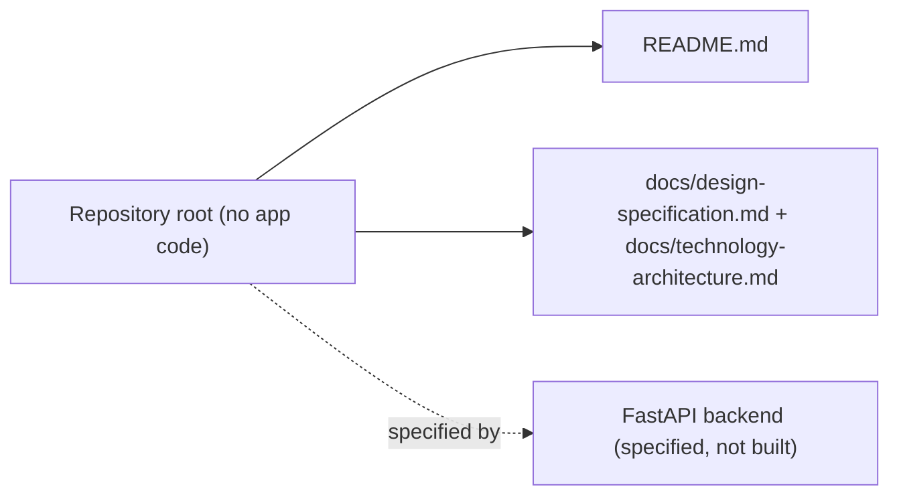
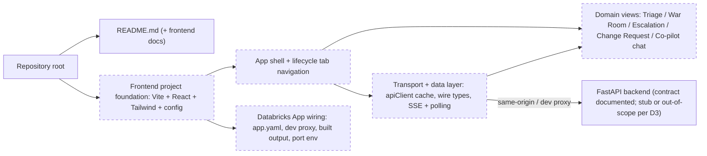
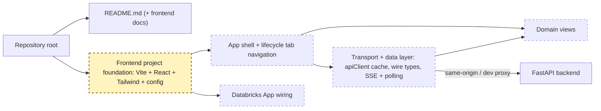
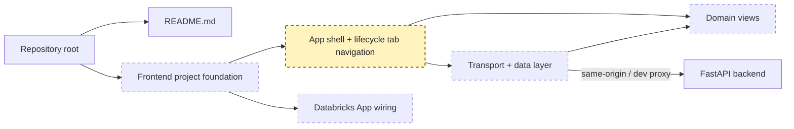
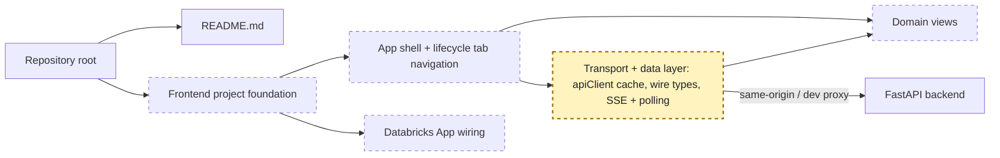
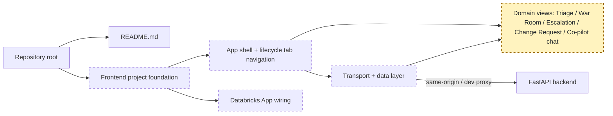
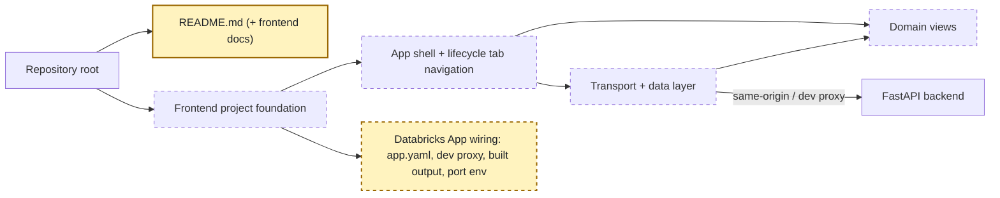

<!-- markdownlint-disable-file -->
# RPI Plan: Scaffold the AI Ops Support System frontend

## Task Metadata

* Task ID: scaffold-frontend
* Task slug: scaffold-frontend
* Plan date: 2026-11-04

## Executive Summary

* Bottom line: Stand up a buildable, deployable single-page web frontend for the Agentic AI Operations Support System, structured after the `databricks-industry-solutions/dbxmetagen` dashboard (Vite + React + Tailwind, a single transport/cache module, `components`/`hooks`/`utils` layout, a committed build output, and a tabbed operational lifecycle), but adapted to this project's domain (Triage → War Room → Escalation → Change Request, plus a co-pilot chat) and this repository's own frontend conventions.
* Why this matters: The repository's design intent is captured in [docs/design-specification.md](../../../docs/design-specification.md) and [docs/technology-architecture.md](../../../docs/technology-architecture.md), but there is no application code yet. A coherent frontend scaffold turns those specifications into a concrete, runnable surface the team can extend feature-by-feature and deploy as a native Databricks App without re-litigating structure, tooling, or the backend contract later.
* Planning result: Complete and revised after one `standard` independent critique. The three coupled decisions (language/stack, placement, backend scope) are resolved; the plan is re-grounded on the `docs/` specifications; one open question remains (the browser-facing API surface and the web-console-vs-Teams approval surface), recorded transparently and non-blocking for a mock-backed scaffold.
* Confidence and uncertainty: High confidence in the reference design, the target domain IA, and the specification-derived contracts. The residual uncertainty is deliberate: the specs define webhook/Teams surfaces and event contracts (`§4`, `§5`) but no browser API, so the web console's endpoints are a net-new backend-for-frontend (BFF) proposal pending backend-owner confirmation.

### What You May Not Know

* The authoritative design sources are [docs/design-specification.md](../../../docs/design-specification.md) and [docs/technology-architecture.md](../../../docs/technology-architecture.md). The earlier `AI_Ops_Support_System_Architecture` Word document and its converted Markdown are an early executive summary; where they differ, the `docs/` specifications win. This plan grounds its requirements and contracts in the `docs/` specs.
* The specs put the human-in-the-loop approvals in **Microsoft Teams Adaptive Cards** (`§4.2`, `§4.4`, `§8` of the design spec), not in a browser. The user explicitly asked to scaffold a web frontend modeled on the dbxmetagen React **dashboard**, so this web console is a **net-new, user-authorized operational surface** that mirrors/complements the Teams approval flow. The plan records this as an assumption rather than claiming the specs mandate a web approval UI, and it keeps Teams-side role re-checks authoritative (`design §8`: card visibility is not authorization).
* The specs define a webhook- and Teams-action-oriented route surface (`tech-arch §4.1`: `/webhooks/*`, `/actions/teams`, `/health/*`) and event/result contracts (`design §5`: Incident event, Diagnosis result) — but **no browser/read API**. The frontend's read/stream endpoints are therefore a proposed BFF contract, labeled net-new and pending backend-owner confirmation; the scaffold runs on mock data (D3) so this does not block it.
* The reference repo uses **JSX, not TSX** (React 19 + Vite 6 + Tailwind 3.4), with all backend calls funneled through a single `apiCache.js` and the built output committed for Databricks Asset Bundle sync. This project's standing instruction [react-typescript-streaming-frontend.instructions.md](../../../../.copilot/instructions/react-typescript-streaming-frontend.instructions.md) mandates **React + TypeScript** and says a repo's own instructions win — resolved as TypeScript in D1.
* This is a **Databricks App** (custom interactive, auth-gated, chat surface), so the standing [databricks-apps.instructions.md](../../../../.copilot/instructions/databricks-apps.instructions.md) invariants apply at deploy time: bind to `DATABRICKS_APP_PORT`, keep same-origin requests (dev-server proxy, not loosened CORS), and never hand-patch built output. Because the backend is Python/FastAPI, the `databricks-apps-python` surface applies rather than the Node AppKit default.
* "Scaffold" here means a buildable app shell with navigation, a typed transport/data layer, mock-backed domain views, a unit-test runner for the pure stream reducer, and Databricks App wiring — not finished features.

## Phase Checklist

### Before



### After



The repository moves from documentation-only to a buildable, deployable SPA: a project foundation (P01) carries an app shell and lifecycle navigation (P02) and a typed transport/data layer (P03); domain placeholder views (P04) render proposals and capture approvals through that layer; Databricks App wiring (P05) makes it deployable and same-origin with the backend, whose contract the data layer targets regardless of whether a stub backend is built (D3).

<!-- rpi:phase id=P01 -->
### [x] P01: Establish the frontend project foundation

Goals:
* A newly created frontend project builds and runs locally with a reproducible toolchain (Vite + React + Tailwind), an established directory layout mirroring the reference repo, a single environment-config module, and a committed-build pipeline — so every later phase has a consistent place to add code and a working `build`/`dev` loop.

Dependencies:
* None



Highlighted work: the `foundation` node — toolchain, directory layout, config module, and build pipeline.

<!-- rpi:task id=P01-T01 -->
#### [x] P01-T01: Create the frontend project and toolchain

Goals:
* A frontend project exists at the agreed location (D2) that installs, runs `dev`, and produces a production `build` with no errors.

Requirements:
* Satisfies FR-001, FR-002, FR-011; NFR-001, NFR-004.
* Create the app at a top-level `frontend/` directory using Vite 6 + React 19 with **TypeScript (TSX)**.
* `package.json` exposes at least `dev`, `build`, `preview`, and `test` scripts; dependencies are pinned to compatible major versions and each non-trivial runtime dependency is justified per NFR-004.
* Tailwind CSS + PostCSS + autoprefixer are configured and active, matching the reference's visual tooling.
* A unit-test runner (Vitest, which integrates with Vite) is installed and wired to the `test` script so the pure stream reducer (NFR-005) and other pure utilities are testable in isolation (`design §9` expects unit coverage of validation and state logic).

Details:
* The reference frontend is a Vite app with `scripts`: `dev`/`build`/`preview` and devDeps `@vitejs/plugin-react`, `tailwindcss`, `postcss`, `autoprefixer`, `vite`; runtime deps include `react`, `react-dom`, and visualization libraries (`recharts`, `@xyflow/react`, `react-force-graph-2d`, `dagre`, `react-joyride`). Add only the visualization/onboarding libraries a scaffold needs; defer the rest to the features that use them (Follow-Up Items).
* The reference uses `node --test`; this scaffold uses Vitest instead because it is the idiomatic Vite + TypeScript test runner and keeps one toolchain. Justify it as the single dev-dependency that enables the NFR-005 validation evidence.
* Prefer the toolchain's own scaffolding (`npm create vite@latest` with the `react-ts` template) over hand-writing config, then adapt. Keep the generated build-output directory generated — never hand-edit it.
* Enable a strict `tsconfig` consistent with the standing instruction's "no `any`" rule.

References:
* [README.md](../../../README.md): current repository state and project description.
* External reference: `databricks-industry-solutions/dbxmetagen` `apps/dbxmetagen-app/app/src/package.json` and `.cursor/rules/frontend-patterns.mdc` (see `## Sources`).

Dependencies:
* None

<!-- rpi:task id=P01-T02 -->
#### [x] P01-T02: Establish the directory layout and environment-config module

Goals:
* The project exposes a predictable structure (`components/`, `hooks/`, `utils/`, `public/`, styles entry, app entry) and one module that is the only reader of `import.meta.env`, with every variable defaulted and mirrored in `.env.example`.

Requirements:
* Satisfies FR-002, FR-006; NFR-002, NFR-003.
* Directory layout mirrors the reference: `components/` (reusable UI), `hooks/` (custom hooks), `utils/` (helpers), `public/` (static assets), plus the app entry (`main.tsx`) and global stylesheet.
* Exactly one environment-config module reads env; a matching `.env.example` lists every variable with a default. No other module reads `import.meta.env` directly (NFR-002).
* The API base URL is configured once and all endpoints derive from it (no second base-URL setting).
* `.env.example` is seeded with the frontend-relevant configuration categories from `tech-arch §10`: the approved API base URL, the API mode (`mock|live`), and feature flags for external writes (disabled by default in dev/test per `tech-arch §10`).

Details:
* Mirror the reference layout so contributors familiar with dbxmetagen navigate this app immediately. Keep transport out of components (enforced in P03).
* The config module and the single-base-URL rule come from the standing streaming-frontend instruction. Ground the variable set in `tech-arch §10` so frontend configuration stays consistent with the system's configuration model; keep backend-only categories (model endpoints, Vector Search indexes, UC names, retry/rate limits) out of the frontend env.

References:
* [.copilot/instructions/react-typescript-streaming-frontend.instructions.md](../../../../.copilot/instructions/react-typescript-streaming-frontend.instructions.md): environment-config and single-base-URL conventions.
* [docs/technology-architecture.md](../../../docs/technology-architecture.md): `§10` environment-configuration categories and external-writes-off-by-default-in-dev.

Dependencies:
* P01-T01

<!-- rpi:phase id=P02 -->
### [x] P02: Build the app shell and lifecycle navigation

Goals:
* A running app renders a persistent shell (header/branding, primary navigation, content region) and lets an operator move between the operational lifecycle sections, establishing the information architecture that domain views plug into — mirroring the reference dashboard's tabbed Generate · Review · Explore model, adapted to this project's lifecycle.

Dependencies:
* P01



Highlighted work: the `shell` node — app root, navigation, and the lifecycle section routing.

<!-- rpi:task id=P02-T01 -->
#### [x] P02-T01: Implement the application shell

Goals:
* The app root renders a consistent layout (branded header, navigation, main content area, and a global state region for loading/error/empty) that wraps all sections.

Requirements:
* Satisfies FR-003; NFR-003, NFR-005.
* A single app-root component composes the shell; sections render inside the content region.
* The shell provides visually distinguishable global states (loading, error, empty) that sections reuse.
* Model- or server-generated content is never rendered via `dangerouslySetInnerHTML`; a restricted, allow-listed renderer is used where rich text is shown (NFR-003).

Details:
* The reference `App.jsx` is a large tabbed root; keep this app's root lean by delegating section bodies to components under `components/`. Establish the shell and shared state affordances here; fill section content in P04.

References:
* External reference: `dbxmetagen` `apps/dbxmetagen-app/app/src/App.jsx` tabbed-shell pattern (see `## Sources`).

Dependencies:
* P01-T02

<!-- rpi:task id=P02-T02 -->
#### [x] P02-T02: Define lifecycle navigation and section routing

Goals:
* An operator can switch between the lifecycle sections — Triage, War Room, Escalations, Change Requests, and Co-pilot chat — with the active section preserved as navigable UI state.

Requirements:
* Satisfies FR-003, FR-004.
* Navigation exposes one entry per lifecycle section; selecting one renders its placeholder view from P04.
* Section identity is a typed union of the lifecycle sections so views and navigation cannot drift.
* No router dependency is added unless justified per NFR-004; tab state via React state is sufficient for a single-page shell.

Details:
* The four lifecycle sections derive from the design spec's core workflows (`§4.1` Incident triage, `§4.2` Teams war room, `§4.3` Jira escalation, `§4.4` Change request drafting); the Co-pilot chat is the conversational surface over the LangGraph orchestrator (`tech-arch §4.2`). This IA adapts the reference's three-tab lifecycle to this domain. Note that `§4.2`/`§4.4` place operator actions in Teams Adaptive Cards; the in-app sections mirror those surfaces per the user-authorized web-console assumption (see D4).

References:
* [docs/design-specification.md](../../../docs/design-specification.md): `§4.1`-`§4.4` define the lifecycle sections and their operator actions.

Dependencies:
* P02-T01

<!-- rpi:phase id=P03 -->
### [x] P03: Implement the transport and data layer

Goals:
* All backend communication flows through one transport module (fetch + caching) with shared wire-contract types, a pure stream-reduction path for the co-pilot chat (SSE), and a polling helper for long-running operations — so components never call `fetch` directly and the backend contract lives in exactly one place.

Dependencies:
* P01



Highlighted work: the `transport` node — API client/cache, wire types, SSE reducer, and polling helper.

<!-- rpi:task id=P03-T01 -->
#### [x] P03-T01: Build the API client and cache module

Goals:
* One module owns request shaping, `fetch`, and response caching; components and hooks import it instead of calling `fetch`.

Requirements:
* Satisfies FR-005, FR-012; NFR-002, NFR-005.
* A single transport module (the `apiCache.js` equivalent) exposes typed functions for each endpoint and handles caching with sensible TTLs.
* Wire-contract types live in one module. Types for domain entities are derived from the design spec `§5` contracts (`Incident event`, `Diagnosis result`); the browser read/stream endpoints themselves are a **net-new backend-for-frontend (BFF) contract** (see D4 and `## Dependencies`), labeled proposed and pending backend-owner confirmation, since `tech-arch §4.1` defines only webhook/Teams/health routes. Data crossing the wire is treated as untrusted until narrowed with explicit guards (no `any`) (NFR-002).
* A dedicated mock layer backs every endpoint in development, selected by an env feature flag (mock vs live), so the app runs end to end without a backend (D3). Auth tokens, if handled client-side, stay in memory for the session only — never `localStorage`/`sessionStorage`, never logged (NFR-003).

Details:
* The reference centralizes all calls through `apiCache.js`; its backend uses daemon-thread + in-memory dict + polling for long operations and SSE only for agent chat. Model the client's surface on that contract: short-lived caches for reads, a submit+poll pattern for long operations, and a streaming reader for chat.
* Implement the mock layer as a typed in-memory module (or MSW handlers) returning `§5`-shaped fixtures; a single env flag (`VITE_API_MODE=mock|live`, resolved only in the config module) switches between mock and the live BFF. This keeps the mock/live seam explicit and reconciles with the P05 dev proxy, which is exercised only in live mode.
* The browser endpoint surface is a proposal in `## Dependencies`; treat it as illustrative, not a frozen contract, until the backend owner confirms it (D4).

References:
* External reference: `dbxmetagen` `.cursor/rules/api-server-patterns.mdc` (polling, caching, SSE) and `apiCache.js` (see `## Sources`).
* [.copilot/instructions/react-typescript-streaming-frontend.instructions.md](../../../../.copilot/instructions/react-typescript-streaming-frontend.instructions.md): transport/wire-type module boundaries and token handling.

Dependencies:
* P01-T02

<!-- rpi:task id=P03-T02 -->
#### [x] P03-T02: Implement the SSE streaming client for the co-pilot chat

Goals:
* The co-pilot chat renders streamed assistant output incrementally through a pure stream-reduction path, with the documented SSE robustness guarantees.

Requirements:
* Satisfies FR-005, FR-007; NFR-002, NFR-003, NFR-005.
* Stream reduction (events → view state) is pure: no I/O, no React, no timers, and is unit-testable in isolation (NFR-005).
* The SSE reader buffers trailing partial lines, tolerates unparseable frames, de-duplicates replayed events/deltas, honors a single `AbortController` for timeout and user cancel, and distinguishes success/error/cancelled/truncated terminal states.
* Streamed deltas render into an ARIA live region so screen readers follow output (NFR-003).

Details:
* These guarantees are mandated verbatim by the standing streaming-frontend instruction and each exists for a real failure mode; keep them even if they look like simplifiable boilerplate. The reference exposes SSE for agent chat only (`/api/agent/deep/stream`, `/api/analyst/stream`) and never uses WebSockets — mirror that choice.

References:
* [.copilot/instructions/react-typescript-streaming-frontend.instructions.md](../../../../.copilot/instructions/react-typescript-streaming-frontend.instructions.md): SSE parsing guarantees, ARIA live region, AbortController, terminal states (contractual for this task).

Dependencies:
* P03-T01

<!-- rpi:phase id=P04 -->
### [x] P04: Scaffold the domain lifecycle views

Goals:
* Each lifecycle section renders a placeholder view wired to the data layer that shows its proposal-and-approval shape — a triage queue, a war-room incident panel, an escalation (Create Jira Bug) panel, a Change Request approval panel, and the streaming co-pilot chat — so the human-in-the-loop flow is visible end to end against mock data and ready for feature work.

Dependencies:
* P02, P03



Highlighted work: the `views` node — the five lifecycle placeholder views and their data-layer wiring.

<!-- rpi:task id=P04-T01 -->
#### [x] P04-T01: Scaffold the Triage and War Room views

Goals:
* The Triage view lists incoming incidents with AI diagnostic summaries, and the War Room view shows a selected incident's detail with schema-drift context and operator actions — both reading from the data layer against mock data.

Requirements:
* Satisfies FR-004, FR-008; NFR-003, NFR-005.
* Triage renders a queue of incidents (correlation ID, source `skybot|servicenow|jira`, severity, service, AI diagnostic summary, status) and supports selecting one; status reflects the spec's workflow states (`awaiting_human_review`, `resolved_with_recommendation`), never a silently closed incident (`design §4.1.7`).
* War Room renders the selected incident's `Diagnosis result` context (summary, probable causes with confidence and evidence, recommended actions, unknowns, source references per `design §5`) and renders operator action affordances (e.g., request a permitted data-quality check) as non-functional placeholders; destructive/production-changing actions are excluded (`design §4.2.4`).
* Both views use the shell's loading/error/empty states and consume data only through the P03 client.

Details:
* Design spec `§4.1` (Incident triage) and `§4.2` (Teams war room) define these surfaces; the war-room Adaptive-Card interactions map to in-app action affordances here, with Teams-side role re-checks remaining authoritative (`design §8`). Keep actions as placeholders — wiring real endpoints is feature work. The diagnosis shape is the `design §5` `Diagnosis result` contract.

References:
* [docs/design-specification.md](../../../docs/design-specification.md): `§4.1`-`§4.2` content and the `§5` `Diagnosis result` contract.

Dependencies:
* P02-T02, P03-T01

<!-- rpi:task id=P04-T02 -->
#### [x] P04-T02: Scaffold the Escalation and Change Request approval views

Goals:
* The Escalation view presents the "Create Jira Bug" proposal with pre-mapped failure context, and the Change Request view presents a drafted CR (code diff, risk assessment, validation logs) with an "Approve and Submit" affordance — both expressing the human-in-the-loop approval pattern against mock data.

Requirements:
* Satisfies FR-004, FR-008; NFR-003, NFR-005.
* Escalation renders the proposed Jira issue fields mapped from incident context (project, issue type, summary, description, severity, incident link per `design §4.3.2`), with a submit affordance (placeholder) and clear indication that it is a proposal.
* Change Request renders the drafted CR sections from `design §4.4.3` (code-change summary, risk assessment, test evidence, rollback plan, linked records) and the `§8` approval controls, which must show the **exact proposed action, affected records, evidence, risk, and rollback information**; an explicit approve/submit affordance captures the approval decision.
* Rich/generated content (diffs, drafted text) renders through the allow-listed renderer, never `dangerouslySetInnerHTML` (NFR-003).

Details:
* Design spec `§4.3` (Jira escalation) and `§4.4` (Change request drafting) define these surfaces; `§8` (human-in-the-loop) mandates the approval-control field set and that only an explicit approval may submit. The defining property is that AI outputs are proposals a human approves; the views must make the proposal/approval boundary obvious and surface the `§8` fields. Acceptance for the end-to-end approval path is governed by `design §9` (no external change without an auditable approval, traceable by correlation ID).

References:
* [docs/design-specification.md](../../../docs/design-specification.md): `§4.3`-`§4.4` content, `§8` approval-control fields, `§9` acceptance criteria.

Dependencies:
* P02-T02, P03-T01

<!-- rpi:task id=P04-T03 -->
#### [x] P04-T03: Scaffold the Co-pilot chat view

Goals:
* The Co-pilot chat view renders a conversation with incremental streamed assistant responses through the P03 SSE client, with visible terminal states and a cancel control.

Requirements:
* Satisfies FR-007; NFR-002, NFR-003, NFR-005.
* The view sends a prompt and renders streamed deltas incrementally into an ARIA live region.
* Success, error, cancelled, and truncated states are visually distinguishable; a cancel control triggers the shared `AbortController`.
* The view holds no transport or parsing logic of its own — it consumes the P03 streaming client and pure reducer.

Details:
* This is the conversational surface over the LangGraph orchestrator (`tech-arch §4.2`). Against a mock stream in dev (D3), it demonstrates the full streaming contract without a live backend. The chat consumes sanitized, task-relevant context only; retrieved content is untrusted (`design §8`, `tech-arch §4.3`).

References:
* [.copilot/instructions/react-typescript-streaming-frontend.instructions.md](../../../../.copilot/instructions/react-typescript-streaming-frontend.instructions.md): incremental rendering and terminal-state visibility.

Dependencies:
* P03-T02

<!-- rpi:phase id=P05 -->
### [x] P05: Wire Databricks App build, deploy, and docs

Goals:
* The frontend is deployable as a native Databricks App and documented: a committed/produced build output served same-origin, a Vite dev proxy to the backend (not loosened CORS), an app definition honoring the port and resource invariants, and README/docs describing dev, build, and deploy — so the scaffold is runnable in-workspace and the team knows how to operate it.

Dependencies:
* P01, P02, P03, P04



Highlighted work: the `appwiring` and `readme` nodes — Databricks App definition, dev proxy, build output, and documentation.

<!-- rpi:task id=P05-T01 -->
#### [x] P05-T01: Configure same-origin dev proxy and build output

Goals:
* `npm run dev` proxies API requests to the backend origin, and `npm run build` produces the servable asset bundle; requests stay relative/same-origin in all environments.

Requirements:
* Satisfies FR-009; NFR-001, NFR-003.
* Vite `server.proxy` routes the app's API path prefix to the backend origin during local dev in live mode; production CORS is not loosened (NFR-003).
* The proxy and the P03 mock layer are reconciled by the single `VITE_API_MODE` flag: mock mode needs no backend; live mode uses the proxy. The default dev mode is mock, so the dev server runs without a backend present.
* The build output directory is treated as generated; the workflow is edit-source-then-rebuild, and the reference repo's "commit the build output" convention is adopted or explicitly rejected per repository preference (recorded in P05-T02).

Details:
* The standing databricks-apps and streaming-frontend instructions both require same-origin + dev proxy over permissive CORS, and both forbid hand-patching built output. Because the scaffold defaults to mock mode (D3), the proxy is dormant until a live backend exists; document both modes.

References:
* [.copilot/instructions/databricks-apps.instructions.md](../../../../.copilot/instructions/databricks-apps.instructions.md): same-origin, built-output, and deployment invariants.
* [.copilot/instructions/react-typescript-streaming-frontend.instructions.md](../../../../.copilot/instructions/react-typescript-streaming-frontend.instructions.md): dev-proxy-over-CORS guidance.

Dependencies:
* P01-T01

<!-- rpi:task id=P05-T02 -->
#### [x] P05-T02: Author the Databricks App definition and operator docs

Goals:
* An app definition declares the app so it can be deployed, binds the correct port, and references resources by name; the README documents how to install, run, build, and deploy the frontend.

Requirements:
* Satisfies FR-009, FR-010; NFR-001.
* The app definition binds to `DATABRICKS_APP_PORT` (never a hardcoded port) and references any warehouse/secret/peer resources via named resources (`valueFrom`), not inline values.
* The relevant `databricks-*` skills (`databricks-core`, `databricks-apps` or `databricks-apps-python`, `databricks-app-design`) are consulted before finalizing the manifest, so the scaffold matches the chosen app surface.
* README (or a `frontend/README`) documents `dev`, `build`, deploy, and the backend-contract expectation.

Details:
* Because this is a Databricks App rendering data and a chat surface, the design skill applies, and because the backend is Python/FastAPI the `databricks-apps-python` surface applies rather than the Node AppKit default — note this divergence from the AppKit default and confirm the app definition's `source_code_path` points at the built frontend output served by FastAPI. Keep secrets and IDs out of code and `env:` literals. Full deployment verification (reading app logs) is an implementation/deploy-stage activity, not a planning claim.

References:
* [.copilot/instructions/databricks-apps.instructions.md](../../../../.copilot/instructions/databricks-apps.instructions.md): which skills to load and the port/identity/resource invariants.
* [README.md](../../../README.md): existing documentation to extend.

Dependencies:
* P05-T01

## User Decisions and Requirements

### Confirmed User Direction

* Scaffold the frontend for this project (Agentic AI Operations Support System on Databricks Apps).
* Use the frontend design of `databricks-industry-solutions/dbxmetagen` as the reference model (stack, layout, transport pattern, tabbed lifecycle, build/deploy approach).
* Context source: this session's `/rpi-plan` invocation; decision-participation mode is `user-owned` (standalone, manual RPI).
* D1 resolved: use **TypeScript (TSX)** + Vite + React + **Tailwind** — honor this repo's standing TypeScript instruction while keeping dbxmetagen's structure and visual design.
* D2 resolved: place the app at a top-level **`frontend/`** directory (single-app repo).
* D3 resolved: **frontend-only** scaffold — documented API contract + mock data + Vite dev proxy; the FastAPI backend is a Follow-Up.
* Web console is user-authorized: the user explicitly requested a web frontend modeled on the dbxmetagen React dashboard, so an in-app operational console is an authorized net-new surface alongside the spec's Teams-based approval flow. The exact browser API surface is an open question (D4).

### Planning Decisions and Feedback

| Group | Decision or feedback item | Status | Owner | Rationale or input needed | Evidence | Planning impact |
|-------|---------------------------|--------|-------|---------------------------|----------|-----------------|
| D1 | Frontend language/stack: TypeScript (TSX) + Vite + React + Tailwind | confirmed | user | User selected TSX + Tailwind: honor this repo's standing TypeScript instruction while keeping dbxmetagen structure and visual parity | [react-typescript-streaming-frontend.instructions.md](../../../../.copilot/instructions/react-typescript-streaming-frontend.instructions.md); dbxmetagen `frontend-patterns.mdc` + `package.json` | Resolved: P01/P03/P04 use TypeScript and Tailwind |
| D2 | Frontend app placement: top-level `frontend/` | confirmed | user | User selected a flat single-app layout | dbxmetagen tree; current repo has no app dirs | Resolved: app lives at `frontend/` and all paths derive from it |
| D3 | Backend scope: frontend-only with documented contract + mock data + dev proxy | confirmed | user | User selected frontend-only; FastAPI backend deferred to Follow-Up | [docs/design-specification.md](../../../docs/design-specification.md); dbxmetagen `api-server-patterns.mdc` | Resolved: P03 uses mock data; no backend phase added |
| D4 | Browser API (BFF) surface and web-console-vs-Teams approval surface: confirm the proposed `/api/*` endpoints and that an in-app approval console is wanted alongside Teams Adaptive Cards | open (non-blocking) | user / backend-owner | Specs define only webhook/Teams/health routes (`tech-arch §4.1`) and place approvals in Teams (`design §4.2/§4.4/§8`); the web console and its read/stream API are net-new. The user authorized the web frontend; the exact endpoints need backend-owner confirmation. Scaffold proceeds on mock data regardless | [docs/technology-architecture.md](../../../docs/technology-architecture.md) `§4.1`; [docs/design-specification.md](../../../docs/design-specification.md) `§4.2`,`§4.4`,`§8` | Shapes P03-T01 wire types and `## Dependencies` BFF contract; does not block the mock-backed scaffold |

## Planning Readiness and Next Step

* Planning Readiness: **Ready** — D1-D3 are resolved, the plan is re-grounded on the `docs/` specifications, and the `standard` critique is complete with all blocking and major findings fixed. One open question (D4, the net-new BFF/web-console surface) is recorded as non-blocking because the scaffold runs on mock data; confirm it with the backend owner before live wiring.
* Next step: implement with `/rpi-implement` using `.copilot-tracking/changes/2026-11-04/scaffold-frontend-changes.md` as the changes-record path.

## Goals

* Produce a buildable, runnable frontend scaffold that mirrors the dbxmetagen dashboard's structure and tooling while honoring this repository's standing frontend and Databricks App instructions.
* Establish the operational-lifecycle information architecture (Triage, War Room, Escalation, Change Request, Co-pilot chat) as navigable placeholder views.
* Centralize backend communication in one typed transport/data layer with a robust SSE streaming path for chat and a polling path for long operations.
* Make the app deployable as a native Databricks App (same-origin, correct port, named resources) with operator documentation.

## Scope and Non-Goals

In scope:
* Frontend project foundation, app shell, lifecycle navigation, transport/data layer, placeholder domain views, and Databricks App build/deploy wiring and docs.
* A documented backend API contract the data layer targets, with mock data for local development.

Non-goals:
* Implementing real backend endpoints, LangGraph orchestration, Mosaic AI model calls, Vector Search, or Unity Catalog access (unless D3 selects a minimal stub, which is still non-functional).
* Real integrations with ServiceNow, Jira, or Microsoft Teams.
* Full feature behavior inside the domain views (charts, graphs, live actions) beyond placeholders wired to the data layer.
* Authentication/authorization implementation beyond honoring in-memory token handling conventions in the scaffold.

## Functional Requirements

* FR-001: The frontend project builds (`build`) and runs (`dev`) locally with no errors.
* FR-002: The project uses Vite + React with the reference's directory layout (`components/`, `hooks/`, `utils/`, `public/`, app entry, global stylesheet).
* FR-003: An app shell renders a persistent header/navigation/content layout with shared loading/error/empty states.
* FR-004: Operators can navigate between the five lifecycle sections, each rendering its placeholder view.
* FR-005: All backend calls flow through a single transport/cache module with shared wire-contract types derived from `design §5`.
* FR-006: Exactly one environment-config module reads env, with a matching `.env.example` seeded from `tech-arch §10` categories and a single configured API base URL.
* FR-007: The Co-pilot chat renders incrementally streamed assistant output via an SSE client with explicit terminal states and cancel.
* FR-008: Triage, War Room, Escalation, and Change Request views express the proposal-and-approval (human-in-the-loop) pattern against mock data, and the approval views surface the `design §8` controls (exact proposed action, affected records, evidence, risk, rollback).
* FR-009: Local dev proxies API requests to the backend origin in live mode (same-origin in production; no loosened CORS), defaults to mock mode, and the build produces servable assets.
* FR-010: An app definition declares the Databricks App with the correct port and named resources, and documentation covers dev/build/deploy.
* FR-011: A unit-test runner (Vitest) is wired to a `test` script so pure logic (the SSE reducer and validation utilities) is testable in isolation.
* FR-012: A single env-selected mock layer backs every endpoint so the app runs end to end without a backend, with a documented mock-vs-live toggle.

## Non-Functional Requirements

* NFR-001: Honor Databricks App invariants — bind to `DATABRICKS_APP_PORT`, reference resources via `valueFrom`, keep secrets/IDs out of code.
* NFR-002: Keep transport, pure stream-reduction, environment config, and wire types as separate modules; data crossing the wire is untrusted until narrowed with explicit guards (no `any`).
* NFR-003: Security — no `dangerouslySetInnerHTML` on generated content, in-memory-only session tokens, same-origin requests with a dev proxy instead of permissive CORS, and accessible streamed output (ARIA live region).
* NFR-004: Justify every runtime dependency; prefer a function over a package; do not add a router/state library without cause.
* NFR-005: The stream-reduction path is pure and unit-testable in isolation; components hold no transport or parsing logic.

## Risks and Open Questions

| Risk or question | Severity | Affected | Notes |
|------------------|----------|----------|-------|
| Browser API (BFF) surface is net-new; specs define only webhook/Teams/health routes | Medium | P03-T01, Dependencies (via D4) | The `/api/*` contract is a proposal pending backend-owner confirmation. Scaffold runs on mock data (D3), so this is non-blocking, but live wiring must reconcile the contract first. |
| Web console duplicates approval surfaces the specs place in Teams | Medium | P04-T01, P04-T02 (via D4) | `design §4.2/§4.4/§8` make Teams the approval surface and require backend role re-checks (card visibility is not authorization). The in-app console mirrors these; it must not become a second authorization authority. |
| Language conflict between the reference (JSX) and this repo's standing instruction (TypeScript) | Low | P01, P03, P04 | Resolved by D1 (TypeScript), which honors the standing instruction; retained as context only. |
| Scaffolding before loading `databricks-*` skills could mismatch the chosen app surface | Medium | P05 | The databricks-apps instruction warns scaffolding-then-consulting forces rework; P05-T02 requires consulting `databricks-apps-python` and `databricks-app-design` before finalizing the manifest. |
| The `docs/` specifications carry no `status` field | Low | All | `design-specification.md` and `technology-architecture.md` have no frontmatter status; treated as current working specs. Confirm they are approved before building production features. |
| Mock-only data leaves end-to-end behavior unverified until the backend exists | Low | P03, P04 | Mitigated by `§5`-derived typed wire layer and a single mock/live flag so backend wiring is mechanical later. |

## Dependencies

* Node.js and npm (or the toolchain the reference uses) for Vite/React builds.
* A Databricks workspace with the Databricks CLI/Asset Bundles for eventual deployment (deploy stage, not planning).
* Specification-defined contracts (authoritative, from [docs/design-specification.md](../../../docs/design-specification.md) `§5`). The frontend's domain types are derived from these; they are system contracts, not invented here:

```json
// design-specification.md §5 — Incident event (inbound)
{
  "event_id": "string",
  "source": "skybot|servicenow|jira",
  "incident_id": "string",
  "severity": "string",
  "service": "string",
  "occurred_at": "ISO-8601 timestamp",
  "payload": {},
  "signature": "string"
}

// design-specification.md §5 — Diagnosis result
{
  "correlation_id": "string",
  "summary": "string",
  "probable_causes": [ {"description": "string", "confidence": 0.0, "evidence": ["string"]} ],
  "recommended_actions": ["string"],
  "unknowns": ["string"],
  "source_references": ["string"],
  "generated_at": "ISO-8601 timestamp"
}
```

* Proposed backend-for-frontend (BFF) browser contract — **net-new, illustrative, pending backend-owner confirmation (D4).** The specs define only webhook/Teams/health routes (`tech-arch §4.1`: `/webhooks/servicenow`, `/webhooks/jira`, `/webhooks/skybot`, `/actions/teams`, `/health/live`, `/health/ready`), so a browser-facing read/stream API does not exist yet. The scaffold targets this proposed surface behind the mock layer; it is not a frozen contract and must be reconciled with the backend owner before live wiring:

```text
GET  /api/incidents                         -> { items: Incident[] }           (list for Triage)
GET  /api/incidents/{correlation_id}        -> IncidentDetail + DiagnosisResult (War Room)
POST /api/operations                        -> { task_id }                      (long op; submit)
GET  /api/operations/{task_id}              -> { status, result }               (poll)
GET  /api/escalations/{correlation_id}/jira -> JiraDraft                        (proposed fields, §4.3.2)
POST /api/escalations/{correlation_id}/jira -> { status, jira_key, url }        (idempotent, §6)
GET  /api/change-requests/{correlation_id}  -> ChangeRequestDraft               (§4.4.3 + §8 fields)
POST /api/change-requests/{correlation_id}/approve -> { status, servicenow_id } (explicit approval, §4.4.5)
POST /api/copilot/stream                    -> text/event-stream (SSE)          (chat, §tech-arch 4.2)
```

* Every mutating browser endpoint must carry the correlation ID and an idempotency key (`tech-arch §6`), and approvals are audited with approver identity, payload hash, timestamp, and resulting external record (`design §4.4.5`, `§8`). These constraints shape the client even though the backend is out of scope (D3).

## Sources

* No formal BRD, PRD, or ADR (with `brd_id`/`prd_id` frontmatter or an `.adr-config.yml`) exists. Search: scanned the repository (`/Users/pchen/dbx-lab/xxx`) for `.adr-config.yml` and Markdown frontmatter carrying `brd_id`/`prd_id`; none found. However, two **authoritative design sources** exist under `docs/` and govern this plan:
  * [docs/design-specification.md](../../../docs/design-specification.md) — purpose, goals/non-goals, high-level architecture, core workflows (`§4.1`-`§4.4`), data contracts (`§5`), security/governance (`§6`), reliability (`§7`), human-in-the-loop requirements (`§8`), testing/acceptance (`§9`), and open implementation decisions (`§10`).
  * [docs/technology-architecture.md](../../../docs/technology-architecture.md) — architecture principles, logical/runtime architecture, FastAPI route groups (`§4.1`), LangGraph states (`§4.2`), agent boundaries (`§4.3`), data/storage (`§5`), integration/idempotency (`§6`), deployment topology (`§7`), security (`§8`), reliability/observability (`§9`), environment configuration (`§10`), and technology decisions (`§11`).
  * Neither file carries a `status` field; treat them as current working design specifications (recorded as a Low gap row in `## Risks and Open Questions`).
* Superseded summary (do not cite as authoritative): the `AI_Ops_Support_System_Architecture` Word document and its converted Markdown are an earlier executive summary; where they differ from the `docs/` specs, the specs win.
* Project README: [README.md](../../../README.md) — current project description.
* Standing instructions (project): [react-typescript-streaming-frontend.instructions.md](../../../../.copilot/instructions/react-typescript-streaming-frontend.instructions.md); [databricks-apps.instructions.md](../../../../.copilot/instructions/databricks-apps.instructions.md).
* External reference design (`databricks-industry-solutions/dbxmetagen`, `main`):
  * `apps/dbxmetagen-app/app/src/package.json` — Vite 6, React 19, Tailwind 3.4, PostCSS, autoprefixer; runtime libs `recharts`, `@xyflow/react`, `react-force-graph-2d`, `dagre`, `react-joyride`.
  * `.cursor/rules/frontend-patterns.mdc` — React 19 + Vite + Tailwind, JSX not TSX, `main.jsx` entry, `apiCache.js` transport, `components/hooks/utils/public` layout, committed build output.
  * `.cursor/rules/api-server-patterns.mdc` — FastAPI backend: daemon-thread + in-memory dict + polling for long ops, SSE for agent chat only, never WebSockets, TTL caches.
  * `apps/dbxmetagen-app/app/src/App.jsx` — tabbed lifecycle shell (Generate · Review · Explore).

## Critique Disposition

* Critique setting: `standard` (default); provenance: no explicit user direction for `deep` or `skip`.
* Critique status: `complete`. Verdict: **Revise** (2 blocking, 4 major, 2 minor). All findings disposed below; the plan was revised directly. Critique artifact: [.copilot-tracking/reviews/plans/2026-11-04/scaffold-frontend-plan-critique.md](../../reviews/plans/2026-11-04/scaffold-frontend-plan-critique.md).
* Independent verification: the critique's central claim — that `docs/design-specification.md` and `docs/technology-architecture.md` exist and were unused — was verified against the filesystem (both files present, added during this session after the initial survey) before acting.

| Finding | Severity | Disposition | Owner | Resolving evidence |
|---------|----------|-------------|-------|--------------------|
| PC-001 | blocking | Fixed | planner | References across Executive Summary, P02-T02, P04-T01/T02/T03, Sources, and the Before diagram re-pointed to [docs/design-specification.md](../../../docs/design-specification.md) and [docs/technology-architecture.md](../../../docs/technology-architecture.md); the "only README + .docx" claim corrected; the `.docx` recorded as a superseded summary. |
| PC-002 | blocking | Fixed (contract corrected) + open question routed to D4 | planner + user/backend-owner | `## Dependencies` now cites the `design §5` contracts as authoritative and labels the browser `/api/*` surface net-new/illustrative pending backend-owner confirmation; P03-T01 derives types from `§5`. The net-new surface is recorded as open decision D4 (non-blocking for a mock scaffold). |
| PC-003 | major | Fixed | planner | P04-T02 now requires the `design §8` approval fields (proposed action, affected records, evidence, risk, rollback) and the `§4.4.3` draft contents, and cites `§9` acceptance; FR-008 updated. |
| PC-004 | major | Fixed | planner | The web console is recorded as a user-authorized net-new surface in Executive Summary, Confirmed User Direction, D4, and Risks; Teams remains the spec's approval surface with backend role re-checks authoritative. |
| PC-005 | major | Fixed | planner | P01-T01 adds Vitest + a `test` script (FR-011); the validation lock and `design §9` grounding reference unit coverage of the pure reducer. |
| PC-006 | major | Fixed | planner | P03-T01 specifies a typed mock layer (or MSW) selected by a single `VITE_API_MODE=mock|live` flag (FR-012); P05-T01 reconciles the dev proxy (live mode only) with the default mock mode. |
| PC-007 | minor | Fixed | planner | P05-T02 notes the bespoke-Vite-vs-AppKit divergence, selects the `databricks-apps-python` surface, and requires confirming `source_code_path` points at the built frontend output. |
| PC-008 | minor | Fixed | planner | P01-T02 and FR-006 ground `.env.example` in `tech-arch §10` categories (API base URL, API mode, external-write feature flags off by default in dev). |

* Test ownership and validation lock: the frontend owns its own build (`build`) and Vitest unit tests for the pure stream reducer and validation utilities (NFR-005, FR-011; `design §9`). Exact removals: `none` (greenfield). Maximum additions: new frontend project files only, all under `frontend/`. Canonical target: the `frontend/` app directory. Coverage: unit-test the pure SSE reducer and any pure narrowing/validation helpers; rely on `build` for integration-level validation at this stage. Validation evidence: a clean `build` and passing `test` run.

## Artifact Self-Check

* Sections are ordered: Metadata → Executive Summary (+ What You May Not Know) → Phase Checklist (Before/After + phases) → User Decisions → Readiness → Goals/Scope/FR/NFR/Risks/Dependencies/Sources → Critique Disposition → Self-Check → Follow-Up → Handoff.
* Every phase has `Goals:`, `Dependencies:`, and a phase diagram; every task has `Goals:`, `Requirements:`, `Details:`, `References:`, `Dependencies:`.
* Code, commands, symbols, and not-yet-created paths use backticks; existing files are Markdown links with workspace-relative text and plan-relative destinations.
* No `applyTo` metadata, `#file:` directives, or line-number references are present.

## Follow-Up Items

* Confirm the net-new BFF browser API contract (D4) with the backend owner, then implement the FastAPI BFF endpoints that adapt the spec's webhook/Teams/orchestrator surfaces (`tech-arch §4.1`-`§4.2`) into the read/stream endpoints the console consumes.
* Implement the FastAPI backend and LangGraph orchestrator (Mosaic AI model calls, Vector Search retrieval, Unity Catalog system-table reads, audit tables, idempotency, dead-letter handling) behind the confirmed contract (`tech-arch §4`-`§9`).
* Build out full feature behavior inside domain views (charts via `recharts`, relationship/graph views via `@xyflow/react`/`react-force-graph-2d`, onboarding via `react-joyride`) once endpoints exist.
* Implement real ServiceNow / Jira / Microsoft Teams integrations and the webhook-driven flows, keeping Teams Adaptive Cards as the specified approval surface and the web console as a complementary operator view.
* Add integration/security tests (`design §9`: replay, unauthorized action, prompt injection, secret leakage) and accessibility testing once live endpoints and real views exist.

## Handoff

* Standalone, manual RPI (`user-owned`). Do not invoke `rpi-implement` from here.
* After D1-D3 are resolved and the `standard` critique's blocking findings are disposed, the implementation-ready command is `/rpi-implement` with `.copilot-tracking/changes/2026-11-04/scaffold-frontend-changes.md` as its changes-record path.
