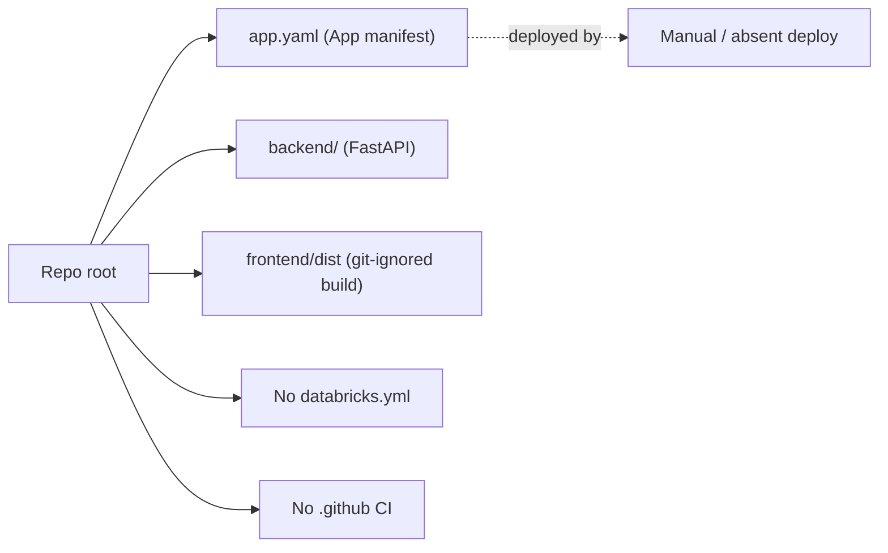
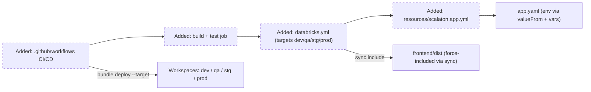
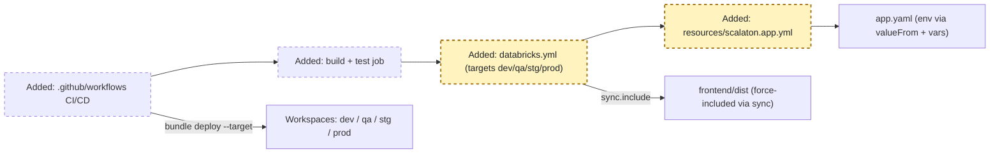
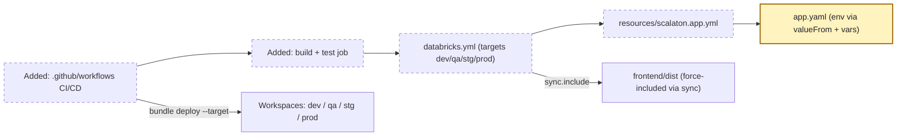
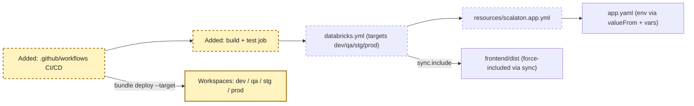
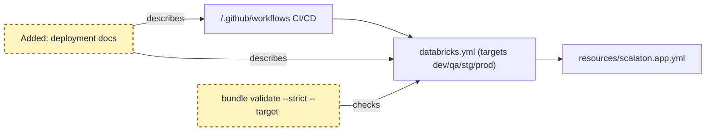

<!-- markdownlint-disable-file -->
# RPI Plan: Databricks Asset Bundle deployment and GitHub Actions CI/CD

## Task Metadata

* Task ID: databricks-dab-cicd-deployment
* Task slug: databricks-dab-cicd-deployment
* Plan date: 2026-11-05

## Executive Summary

* Bottom line: Add a Databricks Asset Bundle (DAB) that deploys the existing Databricks App (`FastAPI` backend serving the built `frontend/dist`) to four environments — `dev`, `qa`, `stg`, `prod` — and a GitHub Actions pipeline that builds, tests, validates, and deploys the bundle to each environment with governed promotion and a production approval gate.
* Why this matters: The repository already has a deployable [app.yaml](../../../app.yaml) but no bundle and no automated deployment. A DAB plus CI makes environment-separated, reproducible, auditable deployments possible, which the technology architecture requires (separate configs, secrets, and service principals per environment).
* Planning result: Complete and implementation-ready for the default topology, with two coupled deployment decisions (environment topology and CI promotion/approval model) surfaced for user confirmation; both have evidence-backed defaults recorded so implementation can proceed if confirmed.
* Confidence and uncertainty: High on bundle and pipeline structure (grounded in the `databricks-dabs` conventions and the existing app manifest). The remaining uncertainty is operational: whether each environment is a separate workspace (recommended) and how promotion is triggered.

### What You May Not Know

* Databricks App names are workspace-global and limited to 30 characters (lowercase letters, digits, hyphens). Each target needs a stable, distinct app name (for example `scalaton-dev`), and `databricks bundle validate` does not reject every invalid name, so names are checked explicitly.
* Apps resources in a DAB carry minimal YAML; runtime environment variables stay in [app.yaml](../../../app.yaml) in the app source directory, not in `databricks.yml`. Per-environment differences are driven through bundle variables and `valueFrom` secret/resource references.
* The frontend build output [frontend/dist](../../../frontend) is git-ignored, so bundle sync excludes it by default. The pipeline must build the frontend before deploy and the bundle must force-include `frontend/dist` via `sync.include`.
* Secrets, warehouse IDs, Vector Search indexes, Genie spaces, and UC catalog/schema are environment-specific and must come from Databricks Secrets and named resources, never from committed source (`tech-arch §8`, `§10`).

## Phase Checklist

### Before



### After



A DAB (`databricks.yml` plus `resources/scalaton.app.yml`) parameterizes the existing app across four environment targets, and a GitHub Actions pipeline builds the frontend, runs backend tests, validates, and deploys the bundle to each environment with gated promotion.

<!-- rpi:phase id=P01 -->
### [x] P01: Bundle foundation and multi-environment targets

Goals:
* The repository has a valid Databricks Asset Bundle that defines the app as a deployable resource and four environment targets (`dev`, `qa`, `stg`, `prod`), so the same app deploys reproducibly to each environment with environment-appropriate names and settings.

Dependencies:
* None



Highlighted work: add `databricks.yml` with four targets and the app resource file `resources/scalaton.app.yml`.

<!-- rpi:task id=P01-T01 -->
#### [x] P01-T01: Author `databricks.yml` with variables and four targets

Goals:
* The bundle root defines the project, includes resource files, declares environment variables, and configures `dev`, `qa`, `stg`, and `prod` targets so each environment resolves its own workspace host, mode, and settings.

Requirements:
* Implements PRD-SCALATON-001 §7 release scope (environment separation; external writes disabled by default in development and test) (`docs/scalaton-product-requirements-document.md`). Supports ADR-SCALATON-001 governed human-in-the-loop posture (`docs/scalaton-adr-001-governed-human-in-the-loop-architecture.md`).
* `databricks.yml` declares `bundle.name`, `include: [resources/*.yml]`, and a `variables:` block for `app_name`, `uc_catalog`, `uc_schema`, `warehouse_id`, `genie_space`, `vector_search_index`, `secret_scope`, and `enable_external_writes`.
* Four targets exist: `dev` (`mode: development`, `default: true`), `qa`, `stg`, and `prod` (`mode: production`). Each target is a separate workspace (D1); authentication host comes from the CLI environment (`DATABRICKS_HOST`) or profile, not from committed YAML interpolation (critique PC-003).
* `enable_external_writes` is `false` in all four targets; live external writes stay disabled until the PRD-SCALATON-001 §7 Release 2 gate passes, enabled later only by the governed change in FU2 (critique PC-002).
* App name values are lowercase letters, digits, and hyphens and at most 30 characters, distinct per target (for example `scalaton-dev`, `scalaton-qa`, `scalaton-stg`, `scalaton-prod`).
* The following is a contract for the target/variable shape (host is supplied by the CLI environment/profile per target, not interpolated here):

```yaml
bundle:
  name: scalaton
include:
  - resources/*.yml
variables:
  app_name: { description: "lowercase/digits/hyphens, <=30 chars" }
  enable_external_writes: { default: "false" }
  # uc_catalog, uc_schema, warehouse_id, genie_space, vector_search_index, secret_scope
targets:
  dev:  { default: true, mode: development, variables: { app_name: scalaton-dev } }
  qa:   { mode: production, variables: { app_name: scalaton-qa } }
  stg:  { mode: production, variables: { app_name: scalaton-stg } }
  prod:
    mode: production
    workspace: { root_path: "/Workspace/Shared/.bundle/${bundle.name}/${bundle.target}" }
    variables: { app_name: scalaton-prod }
```

Details:
* Each target authenticates to its own workspace through the CLI: CI jobs export that environment's `DATABRICKS_HOST` plus OAuth `DATABRICKS_CLIENT_ID`/`DATABRICKS_CLIENT_SECRET` (the CLI reads these); local developers select a per-environment CLI profile. Do not place `${DEV_HOST}`-style shell interpolation in the committed YAML — bundle substitution does not resolve it (critique PC-003). Committing literal per-target hosts is an acceptable alternative if the team prefers explicit hosts.
* Workspace `root_path` for production targets should be a stable shared path such as `/Workspace/Shared/.bundle/${bundle.name}/${bundle.target}` so deploys do not depend on the deployer identity.
* The illustrative block above is a shape contract; exact catalog/schema/warehouse values are environment inputs supplied through variables and secrets, not committed here.

References:
* [app.yaml](../../../app.yaml): current app manifest, env var names, and the note directing deployment through Asset Bundles.
* [docs/scalaton-technology-architecture.md](../../../docs/scalaton-technology-architecture.md): `§7` deployment topology and environment separation, `§10` environment configuration categories.
* [docs/scalaton-product-requirements-document.md](../../../docs/scalaton-product-requirements-document.md): `§7` release scope and external-write gating.

Dependencies:
* None

<!-- rpi:task id=P01-T02 -->
#### [x] P01-T02: Author the app resource and sync configuration

Goals:
* The bundle has an app resource that points at the app source and includes the built frontend, so `bundle deploy` uploads a runnable app for each target.

Requirements:
* Implements the Databricks Apps bundle resource contract. Supports PRD-SCALATON-001 §7 (deployable Release 1 scaffold).
* `resources/scalaton.app.yml` declares `resources.apps.scalaton` with `name: ${var.app_name}`, a description, and `source_code_path` resolving to the app source that contains [app.yaml](../../../app.yaml).
* The bundle forces inclusion of the git-ignored build output so the deployed app can serve it: a `sync.include` entry for `frontend/dist/**`.
* Because `source_code_path` resolves to the repository root, the bundle bounds the upload with explicit root-relative `sync.exclude` entries so no CI, tracking, documentation, local-environment, cache, test, or dependency content is uploaded: at least `.github/**`, `.copilot-tracking/**`, `docs/**`, `.env*`, `.databricks/**`, `**/.venv/**`, `**/node_modules/**`, `**/.pytest_cache/**`, `backend/tests/**`, and `frontend/node_modules/**` (critique PC-004).
* The resolved app name for every target is re-checked against the 30-character lowercase/digits/hyphens rule after `bundle validate` (validation alone does not guarantee a deployable name).
* The following is a contract for the app resource shape:

```yaml
resources:
  apps:
    scalaton:
      name: ${var.app_name}
      description: "Scalaton AI Operations Support Co-pilot"
      source_code_path: ../
```

Details:
* `source_code_path` is the directory uploaded as the app source; because [app.yaml](../../../app.yaml) lives at the repository root and sets `PYTHONPATH: backend`, the source path resolves to the bundle root. Keep `resources/` one level deep so the `../` path reaches the root (path resolution differs by file location).
* Confirm whether `frontend/dist` and `.venv` appear in [frontend/.gitignore](../../../frontend/.gitignore) and [backend/.gitignore](../../../backend/.gitignore); use `sync.include`/`sync.exclude` to force-include the build and keep heavy or secret-bearing directories out of the uploaded source.

References:
* [app.yaml](../../../app.yaml): app command, `PYTHONPATH`, and `valueFrom` resource wiring.
* [frontend/package.json](../../../frontend/package.json): `build` script (`tsc -b && vite build`) that produces `frontend/dist`.

Dependencies:
* P01-T01

<!-- rpi:phase id=P02 -->
### [x] P02: Per-environment configuration and secrets wiring

Goals:
* Each environment runs with its own catalog, schema, warehouse, Genie space, Vector Search index, secret scope, and external-write flag sourced from Databricks Secrets and named resources, so no environment-specific value or secret is committed to source.

Dependencies:
* P01



Highlighted work: wire [app.yaml](../../../app.yaml) environment variables to per-target bundle variables and `valueFrom` secret/resource references.

<!-- rpi:task id=P02-T01 -->
#### [x] P02-T01: Wire app environment variables to secrets and resources

Goals:
* The app manifest resolves model, retrieval, data, Teams, and feature-flag configuration per environment from named resources and Databricks Secrets rather than committed literals.

Requirements:
* Implements `tech-arch §10` environment-configuration categories and `§8` secret handling. Supports PRD-SCALATON-001 §7 and ADR-SCALATON-001 (credentials retrieved at runtime, never committed).
* Bundle variable substitution applies to bundle/resource YAML, not to the uploaded [app.yaml](../../../app.yaml); per-environment values therefore reach the running app only through app `resources` and secret references, not through bundle variables alone (critique PC-001).
* Resource-backed values are declared as app `resources` (a SQL warehouse, and the Genie space / Vector Search index where modeled as resources) and injected into the app as env vars through distinct `valueFrom` names for `SQL_WAREHOUSE_ID`, `GENIE_SPACE`, and `VECTOR_SEARCH_INDEX`.
* The three connector webhook secrets use three distinct `valueFrom` keys (for example `SERVICENOW_WEBHOOK_SECRET`, `JIRA_WEBHOOK_SECRET`, `SKYBOT_WEBHOOK_SECRET`) within the environment's secret scope — one `valueFrom` cannot represent three keys.
* Per-environment scalar configuration that differs by target (`UC_CATALOG`, `UC_SCHEMA`, `MODEL_ENDPOINT`, `WEBHOOK_RATE_LIMIT_PER_MINUTE`, `APPROVAL_POLICY`, `ENABLE_EXTERNAL_WRITES`) is supplied from the environment's Databricks secret scope via `valueFrom`, because the uploaded `app.yaml` is static across a deploy.
* `ENABLE_EXTERNAL_WRITES` resolves to `false` in all four environments; enablement is deferred to the FU2 governed change after the PRD §7 Release 2 gate (critique PC-002).
* No secret value, workspace URL, warehouse ID, or index identifier is committed; secrets come from a Databricks secret scope named by the `secret_scope` variable per environment.

Details:
* The scaffold already reads every value from the environment through [backend/app/config.py](../../../backend/app/config.py) `Settings.from_env`, so this task changes manifest/bundle wiring only, not backend code.
* Bundle-level `--var`/`BUNDLE_VAR_*` govern bundle YAML (app name, resource IDs, secret scope name) in CI; they do not set app runtime env directly — the app resource and `valueFrom` wiring above is what injects runtime values.
* Document which resources and secret scopes each environment requires (warehouse, Genie space, Vector Search index, connector webhook secrets, scalar config keys) so the platform owner can provision them before first deploy.

References:
* [app.yaml](../../../app.yaml): `env` and commented `valueFrom` references to activate.
* [backend/app/config.py](../../../backend/app/config.py): environment variable names the manifest must supply.
* [docs/scalaton-technology-architecture.md](../../../docs/scalaton-technology-architecture.md): `§8` secrets, `§10` configuration categories.

Dependencies:
* P01-T02

<!-- rpi:phase id=P03 -->
### [x] P03: GitHub Actions build, validate, and deploy pipeline

Goals:
* A GitHub Actions pipeline builds the frontend, runs backend tests, validates the bundle, and deploys to the correct environment using that environment's service-principal credentials, with governed promotion and a production approval gate, so deployments are automated, auditable, and human-approved where required.

Dependencies:
* P01, P02



Highlighted work: add the workflow(s) under `.github/workflows/` and the per-environment deploy jobs targeting the four workspaces.

<!-- rpi:task id=P03-T01 -->
#### [x] P03-T01: Build-and-test job

Goals:
* Every pipeline run produces a tested backend and a built frontend artifact before any deployment, so a broken build or failing test never reaches a workspace.

Requirements:
* Supports PRD-SCALATON-001 §7 Release 1 gate (unit, workflow, and approval-boundary tests pass before deployment).
* A workflow job installs frontend dependencies and runs `npm ci`, `npm run build`, and `npm test` (`vitest run`) in [frontend](../../../frontend), producing `frontend/dist` and exercising frontend tests (critique PC-005).
* The same or a parallel job installs backend dependencies and runs the full backend test suite in [backend](../../../backend) with `uv sync --extra dev` then `uv run pytest`.
* The built `frontend/dist` is available to the deploy jobs (same runner sequence or an uploaded artifact).
* The pipeline fails fast when either the build or any test suite fails.

Details:
* Backend tests are offline and fast (the scaffold runs with stubs), so no live Databricks dependency is needed in CI for the build-and-test stage.
* Prefer `astral-sh/setup-uv` (or `uv` via pip) for the backend and `actions/setup-node` for the frontend; pin action versions.

References:
* [frontend/package.json](../../../frontend/package.json): `build` and `test` scripts.
* [backend/pyproject.toml](../../../backend/pyproject.toml): `dev` extra and `pytest` configuration.
* [backend/README.md](../../../backend/README.md): local build/test commands.

Dependencies:
* P02-T01

<!-- rpi:task id=P03-T02 -->
#### [x] P03-T02: Per-environment validate-and-deploy jobs with promotion gates

Goals:
* The pipeline validates and deploys the bundle to `dev`, `qa`, `stg`, and `prod` using GitHub Environments and that environment's service-principal credentials, with `prod` requiring an approval before deploy.

Requirements:
* Implements `tech-arch §7` environment separation (separate configs, secrets, and service principals per environment). Supports PRD-SCALATON-001 §7 Release 2 gate (external writes remain disabled until owners approve).
* Each environment has a GitHub Environment (`dev`, `qa`, `stg`, `prod`) holding `DATABRICKS_HOST`, `DATABRICKS_CLIENT_ID`, and `DATABRICKS_CLIENT_SECRET` for that workspace's OAuth machine-to-machine service principal.
* Deploy jobs install the Databricks CLI (`databricks/setup-cli`), run `databricks bundle validate --strict --target <env>`, then `databricks bundle deploy --target <env>`, authenticating via the environment's OAuth secrets.
* The `prod` environment enforces required reviewers so a human approves before the production deploy runs; promotion to `qa`/`stg`/`prod` is explicit, not automatic on every commit.
* Promotion runs only against the default branch or an explicit commit SHA from a successful `dev` run, and the pipeline builds and tests that exact SHA before deploying, so `qa`/`stg`/`prod` receive the same validated commit rather than an arbitrary `workflow_dispatch` ref (critique PC-006).
* After deploy, a verification step confirms the app is running (for example `databricks apps get <app-name> -o json` showing a running state).
* No workspace URL or credential is committed; all come from GitHub Environment secrets.

Details:
* Promotion model (confirmed — D2): auto-deploy `dev` on push to the default branch; promote to `qa`, `stg`, then `prod` through `workflow_dispatch` with an environment input and GitHub Environment protection rules, with `prod` gated by required reviewers. Constrain the dispatch ref to the default branch (or a validated SHA) per the provenance requirement above.
* Resolve the app name explicitly for each target before deploy and, when a workspace is shared across non-production targets, persist a distinct uncommitted `app_name` override; the default topology uses a separate workspace per environment so names do not collide.
* Keep the deploy job matrix or reusable-workflow structure DRY so the four environments share one validated job definition with different inputs/secrets.

References:
* [app.yaml](../../../app.yaml): deployment note (deploy through Asset Bundles, not ad-hoc `databricks apps deploy`).
* [docs/scalaton-technology-architecture.md](../../../docs/scalaton-technology-architecture.md): `§7` separate service principals and configs per environment.

Dependencies:
* P03-T01

<!-- rpi:phase id=P04 -->
### [x] P04: Local validation and operator documentation

Goals:
* A platform owner can validate the bundle locally, understands the required resources, secrets, and service principals per environment, and knows how promotion and the production gate work, so the deployment is reproducible and operable beyond CI.

Dependencies:
* P01, P02, P03



Highlighted work: run `bundle validate` for each target and add deployment/runbook documentation.

<!-- rpi:task id=P04-T01 -->
#### [x] P04-T01: Validate the bundle and document deployment

Goals:
* The bundle validates cleanly for each target and a deployment guide documents prerequisites, promotion flow, and the production approval gate.

Requirements:
* Supports PRD-SCALATON-001 §8 acceptance (environment configuration is reproducible and documented).
* `databricks bundle validate --strict --target <env>` passes for `dev`, `qa`, `stg`, and `prod`, and each resolved `resources.apps.scalaton.name` satisfies the 30-character lowercase/digits/hyphens rule.
* A deployment document (a new `docs` deployment page or a section in [README.md](../../../README.md)) describes required per-environment resources (warehouse, Genie space, Vector Search index, secret scope, service principal), the GitHub Environment secrets, the promotion flow, and the production approval gate.
* The documentation states that external writes stay disabled in `dev`/`qa` and are enabled only through a governed `stg`/`prod` change (PRD-SCALATON-001 §7).

Details:
* Validation that reaches a live workspace needs credentials; where live validation is unavailable in the planning or CI sandbox, record it as an environment prerequisite rather than a plan gap.
* Keep tracking-folder paths out of committed documentation and manifests.

References:
* [README.md](../../../README.md): existing deployment overview to extend.
* [app.yaml](../../../app.yaml): invariants to echo in the deployment guide.

Dependencies:
* P03-T02

## User Decisions and Requirements

### Confirmed User Direction

* Add a Databricks Asset Bundle (DAB) to deploy the app to `dev`, `qa`, `stg`, and `prod` environments.
* Embed the deployment into a GitHub Actions pipeline.
* D1 confirmed: each environment (`dev`/`qa`/`stg`/`prod`) is a separate Databricks workspace with its own host, service principal, and secrets.
* D2 confirmed: auto-deploy `dev` on push to the default branch; promote `qa`/`stg`/`prod` via manual `workflow_dispatch` with GitHub Environment gates; `prod` requires human approval (required reviewers).
* CI tooling confirmed: `npm` (frontend) and `uv` (backend), matching the repository.

### Planning Decisions and Feedback

| Group | Decision or feedback item | Status | Owner | Rationale or input needed | Evidence | Planning impact |
|-------|---------------------------|--------|-------|---------------------------|----------|-----------------|
| D1 | Environment topology: separate Databricks workspace (host, service principal, secrets) per environment. | confirmed | user | Confirmed separate workspaces per environment. | `tech-arch §7`; user confirmation 2026-11-05 | `databricks.yml` targets use distinct hosts/profiles (P01-T01); app names distinct per target (P01-T02); CI secrets per GitHub Environment (P03-T02) |
| D2 | CI promotion: auto-deploy `dev` on push to default branch; promote `qa`/`stg`/`prod` via `workflow_dispatch` + GitHub Environment gates; `prod` requires approval. | confirmed | user | Confirmed recommended model with prod approval. | GitHub Environments required reviewers; PRD-SCALATON-001 §7; user confirmation 2026-11-05 | Workflow triggers and prod gate (P03-T02) |

## Planning Readiness and Next Step

* Readiness: Ready. D1 (separate workspaces) and D2 (auto-dev / manual promotion with prod approval) are confirmed; the proposed defaults stand with no structural change. The P03-T02 promotion note reflects the confirmed model.
* Next step: run the standard independent critique, then `/rpi-implement`.

## Goals

* Deploy the existing Databricks App to four governed environments through a reproducible Databricks Asset Bundle.
* Automate build, test, validation, and deployment through GitHub Actions with environment separation and a production approval gate.

## Scope and Non-Goals

* In scope: `databricks.yml`, `resources/scalaton.app.yml`, per-environment bundle variables and `valueFrom` wiring in [app.yaml](../../../app.yaml), GitHub Actions workflow(s), and deployment documentation.
* Non-goals: provisioning the actual workspaces, service principals, secret scopes, warehouses, Genie spaces, or Vector Search indexes (platform-owner prerequisites); enabling live external writes or live integrations; changing backend or frontend application behavior; introducing Delta/Vector Search live adapters (Release 2).

## Functional Requirements

* FR-D1: A DAB defines the app and four targets (`dev`, `qa`, `stg`, `prod`) with environment-appropriate names and settings.
* FR-D2: Per-environment configuration and secrets resolve from bundle variables, named resources, and Databricks Secrets, never committed literals.
* FR-D3: A GitHub Actions pipeline builds the frontend, runs backend tests, validates the bundle, and deploys to each environment with gated promotion and a production approval.
* FR-D4: The bundle validates cleanly per target and the deployment is documented.

## Non-Functional Requirements

* NFR-D1: No secrets, workspace URLs, or environment-specific identifiers are committed to source.
* NFR-D2: Production and non-production environments use separate configurations, secrets, and service principals (`tech-arch §7`).
* NFR-D3: External writes remain disabled in all four environments until the PRD-SCALATON-001 §7 Release 2 gate; enablement is a later governed change (FU2), not part of this plan.
* NFR-D4: App names are workspace-global, 30-character, lowercase/digits/hyphens, and distinct per target.

## Risks and Open Questions

| ID | Risk or question | Severity | Affected | Mitigation / note |
|----|------------------|----------|----------|-------------------|
| R1 | Environment topology confirmed as separate workspaces per environment (D1); app names stay distinct per target and no shared-workspace global-name collision applies. | Low | P01-T01, P01-T02, P03-T02 | Resolved by D1; keep distinct app names `scalaton-<env>` |
| R2 | `frontend/dist` is git-ignored; if `sync.include` is omitted the deployed app has no UI assets. | Medium | P01-T02, P03-T01 | Build in CI before deploy and force-include `frontend/dist/**` via `sync.include` |
| R3 | Live `bundle validate`/deploy and app-running verification need workspace credentials not available in a planning or offline sandbox. | Low | P03-T02, P04-T01 | Record as an environment prerequisite; run validation where credentials exist |
| R4 | PRD-SCALATON-001 status is `Draft for product and engineering review`; BRD-SCALATON-001 status is `Draft for stakeholder review`. | Low | P01-T01, P03-T02 | Cite current drafts; re-confirm if a later approved version changes release-gate wording |
| R5 | ADR-SCALATON-002 status is `Proposed for Release 2 implementation`; it does not gate this deployment work. | Low | — | No action; deployment targets the Release 1 app |

## Dependencies

* Existing deployable [app.yaml](../../../app.yaml), [frontend/package.json](../../../frontend/package.json) build, and [backend/pyproject.toml](../../../backend/pyproject.toml) test configuration.
* Platform-owner prerequisites (workspaces, service principals, secret scopes, warehouses, Genie spaces, Vector Search indexes) — provisioned outside this plan.
* Databricks CLI (bundle support) in CI via `databricks/setup-cli`.

## Sources

* Business sources cited: [docs/scalaton-product-requirements-document.md](../../../docs/scalaton-product-requirements-document.md) (PRD-SCALATON-001, status Draft), [docs/scalaton-adr-001-governed-human-in-the-loop-architecture.md](../../../docs/scalaton-adr-001-governed-human-in-the-loop-architecture.md) (ADR-SCALATON-001, status Accepted).
* Engineering references: [docs/scalaton-technology-architecture.md](../../../docs/scalaton-technology-architecture.md) (`§7` deployment topology, `§8` security, `§10` environment configuration), [docs/scalaton-design-specification.md](../../../docs/scalaton-design-specification.md).
* Search performed: scanned [docs](../../../docs) for BRD/PRD/ADR documents and deployment/environment terms ("deploy", "environment", "service principal", "release"). Result: BRD-SCALATON-001, PRD-SCALATON-001, ADR-SCALATON-001, ADR-SCALATON-002 found; deployment/environment requirements concentrated in PRD §7 and tech-arch §7/§10. No other relevant business sources found.
* Domain conventions: `databricks-dabs` skill (bundle structure, multi-target, Apps resource, 30-char app-name contract).

## Critique Disposition

* Critique setting: standard (default); provenance: no explicit user direction to skip or deepen.
* Status: complete. One standard independent critique ran after D1/D2 confirmation; verdict Revise with six planner-correctable findings, all applied in one batch. Output: [.copilot-tracking/reviews/plans/2026-11-05/databricks-dab-cicd-deployment-plan-critique.md](../../reviews/plans/2026-11-05/databricks-dab-cicd-deployment-plan-critique.md).
* Test ownership for this plan: the backend `pytest` suite and frontend `vitest`/build are existing; this plan adds no application tests and removes none. Validation evidence is `bundle validate --strict` per target plus the existing suites in CI.
* A follow-up critique was not rerun: corrections were wiring clarifications and policy tightening within the existing scope and architecture, not a requirements/scope/architecture change.

| Finding | Severity | Disposition | Resolution |
|---------|----------|-------------|------------|
| PC-001 | Blocker | Applied (planner) | P02-T01 now specifies concrete runtime wiring: app `resources` + distinct `valueFrom` names, three separate webhook secret keys, and per-environment secret-scope scalars; bundle vars govern YAML only. |
| PC-002 | High | Applied (planner) | `enable_external_writes` is `false` in all four targets (P01-T01, P02-T01); enablement deferred to FU2 after the PRD §7 gate. |
| PC-003 | Blocker | Applied (planner) | P01-T01 removes `${HOST}` interpolation; host comes from CLI env/profile per target; contract updated. |
| PC-004 | Medium | Applied (planner) | P01-T02 adds explicit root-relative `sync.exclude` entries bounding the upload. |
| PC-005 | Medium | Applied (planner) | P03-T01 runs `npm test` and the full `uv run pytest` suite before deploy. |
| PC-006 | High | Applied (planner) | P03-T02 constrains promotion to the default branch / validated SHA and builds+tests that SHA before deploy. |

## Follow-Up Items

* FU1 (outside active scope): provision per-environment workspaces, OAuth M2M service principals, secret scopes, warehouses, Genie spaces, and Vector Search indexes. Owner: platform owner; prerequisite for first deploy.
* FU2 (outside active scope): define the Release 2 governed change that enables external writes in `stg`/`prod` after the PRD §7 readiness gate.

## Handoff

* Standalone invocation. After D1/D2 confirmation and the standard critique, run `/rpi-implement` with `.copilot-tracking/changes/2026-11-05/databricks-dab-cicd-deployment-changes.md` as the changes-record path.
