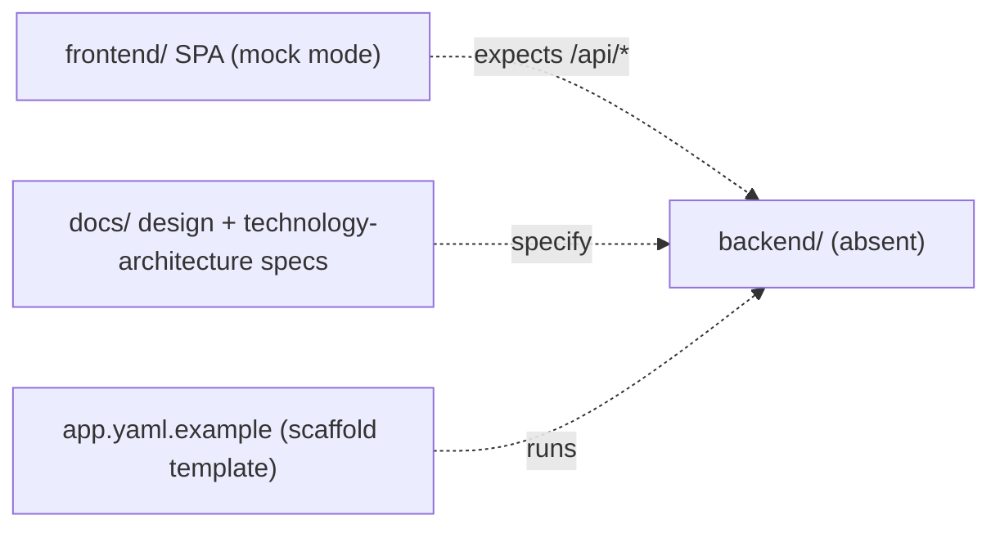

<!-- markdownlint-disable-file -->
# RPI Plan: Scaffold the AI Ops Support System FastAPI + LangGraph backend

## Task Metadata

* Task ID: scaffold-backend
* Task slug: scaffold-backend
* Plan date: 2026-11-05

## Executive Summary

* Bottom line: Stand up a buildable, runnable Python/FastAPI backend scaffold for the Agentic AI Operations Support System — a LangGraph multi-agent orchestrator, the design-spec route surface, typed data contracts, an intelligence/integration layer (Mosaic AI, Vector Search, Unity Catalog, Databricks AI Functions), an MCP connection layer, Genie integration, an AI research agent, external connectors, and the security/audit/reliability/observability primitives the specifications require — structured so each capability has a typed interface and the whole app runs locally without live external dependencies.
* Why this matters: The repository has an authoritative design ([docs/design-specification.md](../../../docs/design-specification.md), [docs/technology-architecture.md](../../../docs/technology-architecture.md)) and a complete mock-backed frontend ([frontend/](../../../frontend)) whose browser contract already targets a backend that does not exist yet. A coherent backend scaffold turns the specifications into a concrete, extensible runtime that serves the frontend's `/api/*` contract, encodes the LangGraph workflow and agent boundaries, and provides the MCP/Genie/AI-function connection points the user asked for — so feature work proceeds without re-litigating structure, contracts, or the integration model.
* Planning result: Complete and revised after one `standard` independent critique (Verdict: Revise — 1 blocking, 5 major, 1 minor; all findings disposed). The four foundational decisions are resolved (D1 `backend/` layout, D2 `uv` + `pyproject.toml`, D3 structured skeleton with local stubs, D4 Databricks-managed MCP servers); the blocking finding (PC-001, approval authority) is resolved by D6 (Teams authoritative; browser console is a proposal surface). Seven phases (P01-P07) with diagrams are in place and the plan is implementation-ready.
* Confidence and uncertainty: High confidence in the required route surface, LangGraph states, agent boundaries, and data contracts (all specification-defined) and in the frontend's net-new BFF contract (read from the committed frontend transport layer). Residual uncertainty is deliberate and recorded: the BFF contract is net-new pending backend-owner confirmation, and the managed-MCP/Genie/AI-function endpoints are real integrations deferred behind stub interfaces (D3), so the scaffold runs locally without them.

### What You May Not Know

* The authoritative sources are [docs/design-specification.md](../../../docs/design-specification.md) and [docs/technology-architecture.md](../../../docs/technology-architecture.md). They define the FastAPI route groups (`tech-arch §4.1`), the LangGraph workflow states (`tech-arch §4.2`), the six agent boundaries (`tech-arch §4.3`), the data contracts (`design §5`), and the security, reliability, and configuration requirements. Neither file carries a frontmatter `status`; both are treated as current working specifications.
* The frontend already defines the **browser-facing (BFF) contract** the backend must serve. It is net-new relative to the specs (which define only webhook/Teams/health routes) and was captured in the frontend plan as decision D4. The exact shapes are readable from [frontend/src/api/apiClient.ts](../../../frontend/src/api/apiClient.ts), [frontend/src/api/streamClient.ts](../../../frontend/src/api/streamClient.ts), and [frontend/src/types/wire.ts](../../../frontend/src/types/wire.ts). The backend scaffold must serve these same-origin and serve the built `frontend/dist` assets.
* The user's request adds capabilities beyond the base specs: **MCP servers**, **Genie agents**, **AI research**, and **other AI functions**. On Databricks these map to managed MCP servers (Genie, Vector Search, Unity Catalog functions), the Genie Conversation API, a research/deep-reasoning agent over governed retrieval, and Databricks AI Functions (for example `ai_query`, `ai_classify`, `ai_extract`). How deep to wire these now is one of the open decisions.
* The specifications place human approval in **Microsoft Teams Adaptive Cards** and require backend role re-checks (`design §8`, `tech-arch §8`): card visibility is not authorization. The scaffold models the approval boundary as a dedicated, audited LangGraph node and keeps external writes disabled by default.
* "Scaffold" here means a buildable, runnable app skeleton with typed contracts, the orchestration graph, agent/adapter/connector/MCP interfaces, and local stub implementations plus unit tests — not finished features and not live external integrations.
* This is a **Databricks App** served by the FastAPI backend ([app.yaml.example](../../../app.yaml.example)); the standing Databricks App invariants apply at deploy time (bind `DATABRICKS_APP_PORT`, reference resources via `valueFrom`, deploy via Asset Bundles when a `databricks.yml` exists, keep secrets out of code).

## Phase Checklist

### Before



### After

```mermaid
%%{init: {"themeVariables": {"fontFamily": "Arial, Helvetica, sans-serif", "fontSize": "16px"}}}%%
flowchart TB
    frontend["frontend/ SPA (served + /api/*)"]
    foundation["Added: backend/ foundation (app factory, config, uv pyproject)"]
    contracts["Added: typed contracts (§5 events, BFF wire, internal models)"]
    routes["Added: FastAPI routes (webhooks, Teams actions, BFF /api/*, SSE, health)"]
    graph["Added: LangGraph orchestrator + agents"]
    intel["Added: intelligence (Mosaic AI, Vector Search, UC, AI Functions)"]
    mcp["Added: MCP connection layer (managed + external) + Genie"]
    platform["Added: security, audit, reliability, observability"]
    connectors["Added: connectors (ServiceNow, Jira, Teams, Skybot) - stub"]
    manifest["Added: Databricks App manifest + bundle"]
    tests["Added: pytest unit tests"]

    foundation --> contracts
    contracts --> routes
    contracts --> graph
    contracts --> intel
    contracts --> connectors
    routes --> graph
    routes -->|serves + /api/*| frontend
    graph --> intel
    graph --> connectors
    graph --> platform
    graph --> mcp
    intel --> mcp
    foundation --> manifest
    tests -->|exercise| graph

    classDef new stroke-dasharray: 5 5
    class foundation,contracts,routes,graph,intel,mcp,platform,connectors,manifest,tests new
```

The repository moves from a mock-only frontend plus specifications to a buildable, runnable backend: a `backend/` foundation (P01) carries typed contracts (P02); the intelligence/MCP layer (P03) and the security/audit/reliability/observability primitives (P04) support the LangGraph orchestrator and agents (P05); the FastAPI routes (P06) dispatch into the orchestrator and serve the frontend's BFF contract same-origin; and tests, the Databricks App manifest, and docs (P07) make it verifiable and deployable. Every integration (Mosaic AI, Vector Search, Unity Catalog, AI Functions, managed MCP servers, Genie, and external connectors) sits behind a typed interface with a local stub, so the app runs without live dependencies (D3).

<!-- rpi:phase id=P01 -->
### [x] P01: Backend project foundation and configuration

Goals:
* A newly created `backend/` project installs with `uv`, runs locally via `uvicorn`, binds `DATABRICKS_APP_PORT` with a local fallback, exposes `app.main:app`, serves the built `frontend/dist`, answers health checks, and reads env-driven configuration (`tech-arch §10`) with no secrets in code — so every later phase has a working run and test loop and one configuration surface.

Dependencies:
* None

```mermaid
%%{init: {"themeVariables": {"fontFamily": "Arial, Helvetica, sans-serif", "fontSize": "16px"}}}%%
flowchart TB
    frontend["frontend/ SPA (served + /api/*)"]
    foundation["Added: backend/ foundation (app factory, config, uv pyproject)"]
    contracts["Added: typed contracts"]
    routes["Added: FastAPI routes"]
    graph["Added: LangGraph orchestrator + agents"]
    intel["Added: intelligence adapters"]
    mcp["Added: MCP connection layer + Genie"]
    platform["Added: security, audit, reliability, observability"]
    connectors["Added: connectors - stub"]
    manifest["Added: Databricks App manifest + bundle"]
    tests["Added: pytest unit tests"]

    foundation --> contracts
    contracts --> routes
    contracts --> graph
    contracts --> intel
    contracts --> connectors
    routes --> graph
    routes -->|serves + /api/*| frontend
    graph --> intel
    graph --> connectors
    graph --> platform
    graph --> mcp
    intel --> mcp
    foundation --> manifest
    tests -->|exercise| graph

    classDef new stroke-dasharray: 5 5
    class foundation,contracts,routes,graph,intel,mcp,platform,connectors,manifest,tests new
    classDef phase fill:#fff3bf,color:#1f2328,stroke:#9a6700,stroke-width:2px
    class foundation phase
```

Highlighted work: the `foundation` node — `backend/` project, `uv` toolchain, app factory, configuration, health, and static serving.

<!-- rpi:task id=P01-T01 -->
#### [x] P01-T01: Create the backend project, toolchain, and FastAPI app factory

Goals:
* A `backend/` project exists that installs with `uv`, runs via `uvicorn app.main:app`, and returns a response from a running FastAPI application bound to the injected port.

Requirements:
* Satisfies FR-001, FR-015; NFR-001, NFR-007, NFR-008.
* Create the project at a top-level `backend/` directory (D1) with an `app/` package and `app/main.py` exposing an `app` ASGI object (`app.main:app`), matching [app.yaml.example](../../../app.yaml.example).
* Manage dependencies with `uv` and a `pyproject.toml` (D2); pin compatible versions, justify each runtime dependency (NFR-008), and generate a `requirements.txt` for the Databricks App runtime.
* The application binds to `DATABRICKS_APP_PORT` at runtime (never hardcode `8080`) with a local development fallback (NFR-001).
* Core runtime dependencies are `fastapi`, `uvicorn`, `pydantic`, and `langgraph`; add the Databricks SDK and MCP client libraries in P03 where they are used, not here.

Details:
* The backend is the Databricks App host that serves the built frontend and the `/api/*` contract. Keep `app/main.py` lean: an app factory that wires configuration, routers (added in P06), and static serving (P01-T02), with a lifespan hook reserved for later resource setup. Prefer an application-factory pattern so tests can construct the app without a live server.
* Use `uv` per the standing uv-projects conventions; keep the generated `requirements.txt` in sync with `pyproject.toml` rather than hand-editing it. Leave framework-version choices to the implementer within the pinned majors.

References:
* [app.yaml.example](../../../app.yaml.example): the `uvicorn app.main:app` entrypoint and the Databricks App invariants the backend must honor.
* [README.md](../../../README.md): the reference architecture topology (FastAPI host, LangGraph brain).
* [docs/technology-architecture.md](../../../docs/technology-architecture.md): `§4.1` FastAPI boundary and `§11` technology decisions.

Dependencies:
* None

<!-- rpi:task id=P01-T02 -->
#### [x] P01-T02: Establish configuration, health endpoints, and static serving

Goals:
* One configuration module reads the environment per `tech-arch §10`, the app answers `/health/live` and `/health/ready` without exposing secrets or incident data, and it serves the built `frontend/dist` same-origin.

Requirements:
* Satisfies FR-001, FR-002, FR-003, FR-013; NFR-001, NFR-002.
* Exactly one settings module reads configuration from the environment and secret references, covering the `tech-arch §10` categories: approved external base URLs, model endpoint names and timeouts, Vector Search index identifiers, Unity Catalog catalog/schema names, retry and rate-limit settings, Teams channel and approval-policy identifiers, and external-write feature flags (disabled by default in dev/test). No secrets are committed or logged (`design §6`).
* `/health/live` reports process liveness and `/health/ready` reports dependency readiness; a readiness failure must not reveal credentials or incident content (`tech-arch §9`).
* The backend serves the built frontend assets (`frontend/dist`) same-origin so the SPA and `/api/*` share an origin (`app.yaml.example` notes the backend serves `./frontend/dist`).

Details:
* Ground the settings in `tech-arch §10`; keep the single-source-of-configuration discipline the frontend already follows. Static serving should tolerate a missing `frontend/dist` in local/dev (the frontend builds separately) without failing startup — log and continue so the API is still usable.
* Health endpoints belong to the Edge layer (`tech-arch §3`); keep readiness checks cheap and side-effect-free in the scaffold (the stub adapters report ready).

References:
* [docs/technology-architecture.md](../../../docs/technology-architecture.md): `§10` configuration categories, `§9` health-check separation, `§3` layer responsibilities.
* [docs/design-specification.md](../../../docs/design-specification.md): `§6` secret handling.
* [frontend/README.md](../../../frontend/README.md): the same-origin and `frontend/dist` build-output expectation.

Dependencies:
* P01-T01

<!-- rpi:phase id=P02 -->
### [x] P02: Typed data contracts and schemas

Goals:
* One schema layer models the `design §5` contracts (Incident event, Diagnosis result), the browser-facing (BFF) wire shapes mirroring the frontend, and the internal typed agent/workflow models, with validation enforced at boundaries — so every route, agent, and adapter exchanges typed models rather than free-form data, and model output is validated before any external send.

Dependencies:
* P01

```mermaid
%%{init: {"themeVariables": {"fontFamily": "Arial, Helvetica, sans-serif", "fontSize": "16px"}}}%%
flowchart TB
    frontend["frontend/ SPA (served + /api/*)"]
    foundation["backend/ foundation"]
    contracts["Added: typed contracts (§5 events, BFF wire, internal models)"]
    routes["Added: FastAPI routes"]
    graph["Added: LangGraph orchestrator + agents"]
    intel["Added: intelligence adapters"]
    mcp["Added: MCP connection layer + Genie"]
    platform["Added: security, audit, reliability, observability"]
    connectors["Added: connectors - stub"]
    manifest["Added: Databricks App manifest + bundle"]
    tests["Added: pytest unit tests"]

    foundation --> contracts
    contracts --> routes
    contracts --> graph
    contracts --> intel
    contracts --> connectors
    routes --> graph
    routes -->|serves + /api/*| frontend
    graph --> intel
    graph --> connectors
    graph --> platform
    graph --> mcp
    intel --> mcp
    foundation --> manifest
    tests -->|exercise| graph

    classDef new stroke-dasharray: 5 5
    class foundation,contracts,routes,graph,intel,mcp,platform,connectors,manifest,tests new
    classDef phase fill:#fff3bf,color:#1f2328,stroke:#9a6700,stroke-width:2px
    class contracts phase
```

Highlighted work: the `contracts` node — `design §5` schemas, BFF wire schemas, and internal agent/workflow models.

<!-- rpi:task id=P02-T01 -->
#### [x] P02-T01: Model the design §5 contracts and the BFF wire shapes

Goals:
* Pydantic models represent the `design §5` Incident event and Diagnosis result, and the browser (BFF) request/response shapes the frontend already consumes, so the backend and frontend share one contract.

Requirements:
* Satisfies FR-003, FR-004; NFR-003. Implements `design §5` (`docs/design-specification.md`) and the net-new BFF contract (D5).
* Model the `design §5` contracts exactly. These are system contracts:

  ```json
  // design-specification.md §5 — Incident event (inbound)
  { "event_id": "string", "source": "skybot|servicenow|jira", "incident_id": "string",
    "severity": "string", "service": "string", "occurred_at": "ISO-8601 timestamp",
    "payload": {}, "signature": "string" }

  // design-specification.md §5 — Diagnosis result
  { "correlation_id": "string", "summary": "string",
    "probable_causes": [ {"description": "string", "confidence": 0.0, "evidence": ["string"]} ],
    "recommended_actions": ["string"], "unknowns": ["string"],
    "source_references": ["string"], "generated_at": "ISO-8601 timestamp" }
  ```

* Model the BFF wire shapes to match [frontend/src/types/wire.ts](../../../frontend/src/types/wire.ts) and the calls in [frontend/src/api/apiClient.ts](../../../frontend/src/api/apiClient.ts): `IncidentListItem`, `IncidentDetail` (list item + `diagnosis`), `JiraDraft`, `ChangeRequestDraft`, `IncidentStatus`, and the operation handle/status types. These are the net-new BFF contract (D5):

  ```text
  GET  /api/incidents                         -> { items: IncidentListItem[] }
  GET  /api/incidents/{correlation_id}        -> IncidentDetail (IncidentListItem + diagnosis)
  GET  /api/escalations/{correlation_id}/jira -> JiraDraft
  POST /api/escalations/{correlation_id}/jira -> { status: created|blocked, jira_key?, url?, reason? }
  GET  /api/change-requests/{correlation_id}  -> ChangeRequestDraft
  POST /api/change-requests/{correlation_id}/approve -> { status: submitted|blocked, servicenow_id?, reason? }
  POST /api/copilot/stream                    -> text/event-stream (SSE)
  ```

* `ChangeRequestDraft` carries the `design §8` approval-control fields (exact proposed action, affected records, evidence, risk, rollback) in addition to the `§4.4.3` draft contents, matching the frontend type.

Details:
* Keep these as a dedicated schemas package so there is one wire-contract source, mirroring how the frontend centralizes types in `wire.ts`. The BFF contract is net-new relative to the specs (the specs define only webhook/Teams/health routes); treat the shapes as the contract the frontend already targets but reconcile with the backend owner before freezing (D5). Field names must match the frontend exactly (snake_case) so the live contract is drop-in.
* The operation handle/status types support the `tech-arch §4.1` async pattern (submit returns a handle; a poll returns status); include them so P06 can expose the async acknowledge-and-process flow.

References:
* [docs/design-specification.md](../../../docs/design-specification.md): `§5` data contracts (authoritative), `§4.4.3` CR contents, `§8` approval-control fields.
* [frontend/src/types/wire.ts](../../../frontend/src/types/wire.ts): the BFF shapes and narrowing guards to mirror.
* [frontend/src/api/apiClient.ts](../../../frontend/src/api/apiClient.ts): the endpoint-to-shape mapping (`JiraSubmitResult`, `ApprovalResult`).

Dependencies:
* P01-T01

<!-- rpi:task id=P02-T02 -->
#### [x] P02-T02: Define internal typed agent and workflow-state models

Goals:
* Internal typed models represent the LangGraph workflow state and the messages agents exchange, so agents communicate through typed models rather than free-form strings and the model-output validation boundary is explicit.

Requirements:
* Satisfies FR-004, FR-005, FR-006; NFR-003.
* Define a workflow-state model carrying the `tech-arch §4.2` fields: correlation ID and source event ID, incident and external-record references, sanitized event context, retrieved-evidence references, diagnosis and confidence, approval state, and connector results and error information.
* Define typed internal models for agent inputs and outputs (evidence bundles, diagnosis drafts, connector requests) so no agent boundary passes free-form strings (`tech-arch §4.3`).
* Model output must be schema-validated against the `design §5` Diagnosis result before it can leave an agent toward any external system; invalid output is representable as an internal error, not an external payload (`design §5`).

Details:
* These internal models are distinct from the wire models in P02-T01: wire models are the external/browser contract; internal models are the orchestrator's working state. Keep the correlation ID central so it threads through agents, connectors, audit, and telemetry (`tech-arch §4.2`, NFR-004).
* The recommended workflow states (`received`, `validating`, `collecting_evidence`, `diagnosing`, `drafting`, `awaiting_human_review`, `executing_approved_action`, `completed`, `failed`) form an internal `WorkflowState` enum that P05 drives. This is distinct from the BFF `IncidentStatus` (the five values in [frontend/src/types/wire.ts](../../../frontend/src/types/wire.ts): `awaiting_human_review`, `resolved_with_recommendation`, `executing_approved_action`, `completed`, `failed`). Define both and an explicit `WorkflowState -> IncidentStatus` mapping (for example internal `diagnosing`/`drafting`/`collecting_evidence` map to the console's `awaiting_human_review`, and a completed-with-recommendation outcome maps to `resolved_with_recommendation`); do not share one enum across the boundary (PC-004).

References:
* [docs/technology-architecture.md](../../../docs/technology-architecture.md): `§4.2` workflow-state fields and recommended states, `§4.3` typed-internal-model boundary.
* [docs/design-specification.md](../../../docs/design-specification.md): `§5` schema-validation-before-external-send rule.

Dependencies:
* P02-T01

<!-- rpi:phase id=P03 -->
### [x] P03: Intelligence and integration layer

Goals:
* The capabilities the user asked for exist behind typed interfaces with local stubs: a Mosaic AI model adapter, a Vector Search retrieval adapter, a Unity Catalog diagnostics adapter, a Databricks AI-Functions adapter, an MCP connection layer that registers the Databricks-managed MCP servers (Genie, Vector Search, Unity Catalog functions) plus a config-driven set of external MCP servers and exposes their tools to LangGraph, and a Genie integration — so agents consume governed tools without any live dependency (D3, D4).

Dependencies:
* P02

```mermaid
%%{init: {"themeVariables": {"fontFamily": "Arial, Helvetica, sans-serif", "fontSize": "16px"}}}%%
flowchart TB
    frontend["frontend/ SPA"]
    foundation["backend/ foundation"]
    contracts["typed contracts"]
    routes["Added: FastAPI routes"]
    graph["Added: LangGraph orchestrator + agents"]
    intel["Added: intelligence (Mosaic AI, Vector Search, UC, AI Functions)"]
    mcp["Added: MCP connection layer (managed + external) + Genie"]
    platform["Added: security, audit, reliability, observability"]
    connectors["Added: connectors - stub"]
    manifest["Added: Databricks App manifest + bundle"]
    tests["Added: pytest unit tests"]

    foundation --> contracts
    contracts --> routes
    contracts --> graph
    contracts --> intel
    contracts --> connectors
    routes --> graph
    routes -->|serves + /api/*| frontend
    graph --> intel
    graph --> connectors
    graph --> platform
    graph --> mcp
    intel --> mcp
    foundation --> manifest
    tests -->|exercise| graph

    classDef new stroke-dasharray: 5 5
    class foundation,contracts,routes,graph,intel,mcp,platform,connectors,manifest,tests new
    classDef phase fill:#fff3bf,color:#1f2328,stroke:#9a6700,stroke-width:2px
    class intel,mcp phase
```

Highlighted work: the `intel` and `mcp` nodes — Databricks intelligence adapters, the MCP connection layer, and Genie.

<!-- rpi:task id=P03-T01 -->
#### [x] P03-T01: Build the Databricks intelligence adapters

Goals:
* Typed adapters expose Mosaic AI model inference, Vector Search retrieval, Unity Catalog system-table diagnostics, and Databricks AI Functions, each with a local stub returning `design §5`-shaped data so agents run without live endpoints.

Requirements:
* Satisfies FR-007; NFR-002, NFR-003, NFR-007, NFR-008. Grounds in `tech-arch §4.3`, `§5`, `§11`.
* A Mosaic AI model adapter interface performs the diagnosis/classification/extraction/draft-generation calls (`design §3`, `tech-arch §11`); the stub returns a schema-valid Diagnosis result.
* A Vector Search retrieval adapter returns runbook/historical-incident references with source references and freshness metadata (`tech-arch §5`); the stub returns fixed references.
* A Unity Catalog diagnostics adapter reads permitted workflow/execution metadata read-only (`tech-arch §4.3` Log Agent boundary; `design §6` read-only default); the stub returns fixed diagnostics.
* A Databricks AI-Functions adapter wraps the SQL-callable AI functions (for example `ai_query`, `ai_classify`, `ai_extract`, `ai_summarize`, `ai_mask`) against a SQL warehouse (D4); the stub returns deterministic results. Prompts and function inputs carry only sanitized, task-relevant context (NFR-002).
* Each adapter is selected between stub and live by configuration (the `tech-arch §10` flags), defaulting to stub so no live dependency is required (NFR-007).

Details:
* Define narrow interfaces (protocols) per capability so the live Databricks implementations drop in later behind the same signature; the agents (P05) depend on the interface, not the implementation. Add the Databricks SDK and SQL-connector dependencies here, where they are used (NFR-008), and keep secrets out of code (NFR-001). When implementing, consult the `databricks-model-serving` / `databricks-ai-functions` / `databricks-vector-search` / `databricks-python-sdk` skills so the live signatures match the platform.
* Treat retrieved runbook/ticket/log text as untrusted input to the model, not instruction (`tech-arch §8` prompt-injection defense); the adapter returns data, and sanitization/redaction is applied before model calls (P04-T02).

References:
* [docs/technology-architecture.md](../../../docs/technology-architecture.md): `§4.3` agent/adapter boundaries, `§5` data domains and retrieval metadata, `§8` untrusted-input rule, `§11` technology decisions.
* [docs/design-specification.md](../../../docs/design-specification.md): `§3` AI-layer responsibilities, `§6` read-only-by-default governance.

Dependencies:
* P02-T02

<!-- rpi:task id=P03-T02 -->
#### [x] P03-T02: Build the MCP connection layer and Genie integration

Goals:
* An MCP connection layer registers the Databricks-managed MCP servers (Genie, Vector Search, Unity Catalog functions) and a config-driven set of external MCP servers, loads their tools for LangGraph, and a Genie integration lets the co-pilot and research paths query Genie — all stubbed locally so no live MCP endpoint is required.

Requirements:
* Satisfies FR-008, FR-009; NFR-001, NFR-002, NFR-007, NFR-008. Implements D4.
* An MCP registry reads server definitions from configuration (`tech-arch §10`): the Databricks-managed MCP servers (Genie, Vector Search, UC functions) and any external MCP servers, each referenced by named resource/secret via `valueFrom`, never inline URLs or tokens (NFR-001).
* An MCP client loads tools from the registered servers and exposes them to LangGraph agents in a form the orchestrator can bind (D4); the stub exposes a small fixed tool set so agents run offline (NFR-007).
* A Genie integration issues natural-language questions and returns answers; generated SQL and source references are retained in the internal result model for auditing and future surfacing, not streamed through the current co-pilot SSE contract (the frame set carries only text/error/truncated/done — see P06-T02 and PC-007). It is reachable through the managed Genie MCP server by default, with the stub returning deterministic answers.
* Tool inputs carry only sanitized, task-relevant context, and tool results are treated as untrusted data (NFR-002, `tech-arch §8`).

Details:
* Databricks provides managed MCP servers for exactly Genie, Vector Search, and UC functions, which is why D4 makes managed MCP the primary tool surface; the external-server registry keeps the door open for custom/team MCP servers. Use an MCP client library (for example `langchain-mcp-adapters` with the LangGraph agents) and add that dependency here. When implementing, consult the `databricks-genie-agents`, `databricks-vector-search`, and `databricks-unity-catalog` skills for the managed-server endpoints and auth model.
* Keep the Genie surface thin: the co-pilot chat (P06) and the Research agent (P05) call it through this layer rather than embedding Genie calls directly, so there is one Genie integration point. Retain generated-SQL and source references in the internal result for audit; surfacing them in the console is a future frontend-contract change because the current SSE contract carries only text/error/truncated/done frames (PC-007).

References:
* [docs/technology-architecture.md](../../../docs/technology-architecture.md): `§4.3` knowledge/diagnosis agents, `§8` untrusted-input and least-privilege, `§10` configuration-by-reference, `§11` Vector Search over governed Delta.
* [app.yaml.example](../../../app.yaml.example): the named-resource/`valueFrom` invariant for Genie spaces, warehouses, and secrets.

Dependencies:
* P02-T02, P03-T01

<!-- rpi:phase id=P04 -->
### [x] P04: Connectors, security, audit, reliability, and observability primitives

Goals:
* The cross-cutting platform primitives the specifications require exist behind interfaces — connector adapters (ServiceNow, Jira, Teams, Skybot) on the `tech-arch §6` contract; webhook signature/timestamp/replay/allowlist verification, redaction, a Teams-action role re-check, and idempotency-key derivation; an append-only audit store; bounded retry/backoff/timeout and dead-letter handling; and correlation-ID-aware logging, metrics, and tracing — so workflows are safe, governed, and observable even against stubs.

Dependencies:
* P02

```mermaid
%%{init: {"themeVariables": {"fontFamily": "Arial, Helvetica, sans-serif", "fontSize": "16px"}}}%%
flowchart TB
    frontend["frontend/ SPA"]
    foundation["backend/ foundation"]
    contracts["typed contracts"]
    routes["Added: FastAPI routes"]
    graph["Added: LangGraph orchestrator + agents"]
    intel["intelligence adapters"]
    mcp["MCP connection layer + Genie"]
    platform["Added: security, audit, reliability, observability"]
    connectors["Added: connectors (ServiceNow, Jira, Teams, Skybot) - stub"]
    manifest["Added: Databricks App manifest + bundle"]
    tests["Added: pytest unit tests"]

    foundation --> contracts
    contracts --> routes
    contracts --> graph
    contracts --> intel
    contracts --> connectors
    routes --> graph
    routes -->|serves + /api/*| frontend
    graph --> intel
    graph --> connectors
    graph --> platform
    graph --> mcp
    intel --> mcp
    foundation --> manifest
    tests -->|exercise| graph

    classDef new stroke-dasharray: 5 5
    class foundation,contracts,routes,graph,intel,mcp,platform,connectors,manifest,tests new
    classDef phase fill:#fff3bf,color:#1f2328,stroke:#9a6700,stroke-width:2px
    class connectors,platform phase
```

Highlighted work: the `connectors` and `platform` nodes — external connectors and the security/audit/reliability/observability primitives.

<!-- rpi:task id=P04-T01 -->
#### [x] P04-T01: Build connector adapters on the §6 adapter contract

Goals:
* Each external system (ServiceNow, Jira, Teams, Skybot) has a stub adapter implementing the `tech-arch §6` contract, so the orchestrator can read and write through a uniform, auditable, idempotent interface without live endpoints.

Requirements:
* Satisfies FR-010; NFR-002, NFR-005, NFR-007. Implements `tech-arch §6`, `design §4.2`-`§4.4`.
* Each adapter follows the five-step `tech-arch §6` contract: validate request/response schemas, attach correlation and idempotency headers where supported, apply bounded retries only to safe transient failures, normalize provider errors into internal categories, and emit an audit event for every external read and write.
* Before creating a Jira issue or submitting a ServiceNow change request, the adapter checks the audit store and any provider-side reference for an existing successful action using the derived idempotency key (`tech-arch §6` idempotency).
* Destructive or production-changing actions are not exposed in the initial action set (`design §4.2.4`); external writes are gated by the external-write feature flag, off by default (NFR-007).
* Stubs return deterministic, schema-valid responses so the escalation and change-request flows run offline.

Details:
* Keep a shared connector base defining the §6 contract and have each provider adapter specialize it, so retries, idempotency, normalization, and auditing are consistent. The live implementations (REST, JWT/OAuth, provider webhooks per `tech-arch §11`) drop in behind the same interface. Teams is both an outbound surface (Adaptive Cards) and the approval surface; keep the adapter outbound-only here and let the inbound Teams action arrive through the route surface (P06) with a backend role re-check (P04-T02).
* Idempotency keys derive from the source event, target system, target record, and action type (`tech-arch §6`); implement that derivation in P04-T02 and consume it here.

References:
* [docs/technology-architecture.md](../../../docs/technology-architecture.md): `§6` adapter contract and idempotency, `§11` integration protocols.
* [docs/design-specification.md](../../../docs/design-specification.md): `§4.2`-`§4.4` connector workflows, `§4.2.4` excluded destructive actions.

Dependencies:
* P02-T02

<!-- rpi:task id=P04-T02 -->
#### [x] P04-T02: Build the security primitives

Goals:
* The backend can verify inbound webhooks, redact sensitive data before model calls, re-check Teams-action roles, and derive stable idempotency keys — the security seams the specifications mandate.

Requirements:
* Satisfies FR-011; NFR-002, NFR-005, NFR-006. Implements `design §6`, `§8`; `tech-arch §6`, `§8`.
* Inbound webhook verification performs provider signature validation, timestamp-freshness checks, replay protection, and source allowlisting; a webhook is acknowledged only after authenticity and minimum schema checks pass (`tech-arch §6` webhook security, `design §6`).
* A redaction step removes tokens, credentials, personal data, and unnecessary payload fields before any model call (`design §6`).
* A Teams-action authorization check re-checks the operator role at the backend; card visibility is not authorization (`tech-arch §8`, `design §4.2`).
* An idempotency-key derivation produces a stable key from the source event, target system, target record, and action type (`tech-arch §6`).
* A configurable per-source rate-limiter seam enforces request limits at the inbound boundary (`tech-arch §3`, `§6`; FR-016); the scaffold provides an in-memory limiter behind an interface, consumed by the webhook routes in P06-T01.

Details:
* These are security-critical seams; implement them as pure, unit-testable functions (P07 covers them per `design §9`) with stub signing keys supplied by configuration, never hardcoded (`design §6`, NFR-001). The scaffold validates the mechanism, not real provider secrets. Keep verification independent of the connector adapters so inbound (verify) and outbound (sign/attach) concerns stay separate.
* Redaction runs on the sanitized event context stored in the workflow state (P02-T02) so downstream agents and model calls only ever see minimized data (NFR-002).

References:
* [docs/design-specification.md](../../../docs/design-specification.md): `§6` webhook auth and redaction, `§8` approval controls and role checks.
* [docs/technology-architecture.md](../../../docs/technology-architecture.md): `§6` webhook security and idempotency, `§8` Teams role re-check.

Dependencies:
* P02-T02

<!-- rpi:task id=P04-T03 -->
#### [x] P04-T03: Build audit, reliability, and observability scaffolding

Goals:
* The backend records immutable audit events, applies bounded retries/timeouts with a dead-letter path, and emits structured logs/metrics/traces carrying the correlation ID — behind interfaces with local stub stores.

Requirements:
* Satisfies FR-012; NFR-004, NFR-005, NFR-006, NFR-007. Implements `design §6`, `§7`; `tech-arch §5`, `§9`.
* An append-only audit event interface records event type, actor or service principal, correlation ID, source ID, timestamp, outcome, payload hash, and external record ID; raw secrets and unnecessary personal data are never stored (`tech-arch §5`, `design §6`). Approvals additionally record approver identity, exact payload hash, timestamp, and resulting external record (`design §8`, NFR-006).
* A reliability helper provides timeouts and bounded retries with exponential backoff and jitter for transient model/connector errors, and a dead-letter interface persists permanently failed events for operator review (`design §7`, `tech-arch §9`).
* Structured logging, metrics, and tracing hooks carry the correlation ID and workflow state across webhook receipt, agent nodes, model calls, retrieval, and external writes (`tech-arch §9`, NFR-004).
* An authorized, audited, idempotent replay interface re-submits dead-lettered events only through an operational entry point (not a public route), checking authorization and the idempotency key and recording an audit event (`design §7`; FR-017).
* The audit and dead-letter stores are in-memory/stub implementations behind interfaces so the scaffold runs without governed Delta tables, with the live Delta/Unity Catalog implementation deferred (NFR-007).

Details:
* The live audit and dead-letter stores are governed Delta tables (`tech-arch §5`); keep them behind an interface so the stub (in-memory append-only list) and the live store share a signature. Correlation-ID propagation is the backbone of observability (`tech-arch §2`, `§9`); thread it from the route layer (P06) through the orchestrator (P05) into every audit event and telemetry span.
* Keep metrics/traces as thin hooks in the scaffold (counters and span context) rather than wiring a full telemetry backend; name the metrics the specs call out (latency, workflow duration, model latency, token usage, retry count, connector failures) so the live wiring is mechanical.

References:
* [docs/technology-architecture.md](../../../docs/technology-architecture.md): `§5` audit-record fields and governed Delta storage, `§9` telemetry and retry/dead-letter.
* [docs/design-specification.md](../../../docs/design-specification.md): `§6` audit storage, `§7` reliability, `§8` approval auditing.

Dependencies:
* P02-T02

<!-- rpi:phase id=P05 -->
### [x] P05: LangGraph orchestrator and agent boundaries

Goals:
* A LangGraph orchestrator encodes the `tech-arch §4.2` workflow states and explicit transitions with external writes isolated in dedicated nodes and a human-approval pause, and the six specified agents plus an AI Research agent are typed, bounded components that consume the P03 intelligence/MCP tools and the P04 platform primitives — so the end-to-end incident workflow is expressed and runnable against stubs.

Dependencies:
* P02, P03, P04

```mermaid
%%{init: {"themeVariables": {"fontFamily": "Arial, Helvetica, sans-serif", "fontSize": "16px"}}}%%
flowchart TB
    frontend["frontend/ SPA"]
    foundation["backend/ foundation"]
    contracts["typed contracts"]
    routes["Added: FastAPI routes"]
    graph["Added: LangGraph orchestrator + agents (Log/Knowledge/Diagnosis/Comm/Escalation/Change/Research)"]
    intel["intelligence adapters"]
    mcp["MCP connection layer + Genie"]
    platform["security, audit, reliability, observability"]
    connectors["connectors - stub"]
    manifest["Added: Databricks App manifest + bundle"]
    tests["Added: pytest unit tests"]

    foundation --> contracts
    contracts --> routes
    contracts --> graph
    contracts --> intel
    contracts --> connectors
    routes --> graph
    routes -->|serves + /api/*| frontend
    graph --> intel
    graph --> connectors
    graph --> platform
    graph --> mcp
    intel --> mcp
    foundation --> manifest
    tests -->|exercise| graph

    classDef new stroke-dasharray: 5 5
    class foundation,contracts,routes,graph,intel,mcp,platform,connectors,manifest,tests new
    classDef phase fill:#fff3bf,color:#1f2328,stroke:#9a6700,stroke-width:2px
    class graph phase
```

Highlighted work: the `graph` node — the LangGraph state machine, the approval boundary, and the seven agents.

<!-- rpi:task id=P05-T01 -->
#### [x] P05-T01: Implement the LangGraph state machine and approval boundary

Goals:
* A LangGraph graph drives an incident through the `tech-arch §4.2` states with explicit transitions, isolates external writes in dedicated nodes, and pauses at a human-approval node before any production-impacting action.

Requirements:
* Satisfies FR-005; NFR-003, NFR-004, NFR-005, NFR-006. Implements `tech-arch §4.2`, `design §8`.
* The graph models the recommended states (`received`, `validating`, `collecting_evidence`, `diagnosing`, `drafting`, `awaiting_human_review`, `executing_approved_action`, `completed`, `failed`) with explicit transitions; a workflow must not silently close an incident (`design §4.1.7`).
* External writes live in dedicated nodes so they can be authorized, retried, and audited independently from model inference (`tech-arch §4.2`).
* A human-approval pause node gates submitting a change request, changing production state, closing/materially changing an incident, and creating external records when policy requires confirmation (`design §8`); resuming requires an explicit approval carrying the audited fields (NFR-006).
* The graph propagates the correlation ID through every node into audit events and telemetry (NFR-004), and uses a checkpointer so a paused workflow can resume.

Details:
* Use LangGraph's state-machine and interrupt/checkpoint features for the approval pause and resume; the workflow state is the P02-T02 model. Keep nodes thin — a node orchestrates agents/adapters and records audit events, it does not embed provider logic. Against stubs the full path runs deterministically, which is what P07 exercises.
* The approval boundary is the defining safety property (`design §8`, `§2` non-goals): analysis and drafting are automated, production-impacting actions are not. Make the pause explicit rather than a flag an agent could bypass.

References:
* [docs/technology-architecture.md](../../../docs/technology-architecture.md): `§4.2` states, transitions, and dedicated external-write nodes.
* [docs/design-specification.md](../../../docs/design-specification.md): `§4.1.7` no-silent-close, `§8` human-in-the-loop boundary, `§2` non-goals.

Dependencies:
* P02-T02, P04-T01, P04-T03

<!-- rpi:task id=P05-T02 -->
#### [x] P05-T02: Implement the agent boundaries

Goals:
* The six specified agents plus an AI Research agent exist as typed, bounded components wired into the graph, each consuming the P03 intelligence/MCP tools and communicating through typed internal models.

Requirements:
* Satisfies FR-006, FR-009; NFR-002, NFR-003. Implements `tech-arch §4.3`.
* Implement the `tech-arch §4.3` agents with their boundaries: Log Agent (reads permitted workflow/Spark metadata, cannot write production data), Knowledge Agent (retrieves runbooks/historical incidents; retrieved text is untrusted context, not instruction), Diagnosis Agent (evidence → structured diagnosis via the Mosaic AI adapter), Communication Agent (ServiceNow notes and Teams cards from validated results), Escalation Agent (maps approved context into Jira fields, preserving cross-system links), and Change Agent (drafts change requests and stops at the approval boundary).
* Add an AI Research agent that performs deeper investigation over governed retrieval (Vector Search and Genie through the P03 layer), synthesizing runbook/historical-incident/UC-metadata evidence into the diagnosis inputs; it reads only and treats retrieved content as untrusted (NFR-002).
* Agents communicate through the P02-T02 typed internal models, never free-form strings (`tech-arch §4.3`, NFR-003), and consume tools via the P03 adapters/MCP layer rather than embedding provider calls.

Details:
* Keep each agent a thin, testable unit with a typed input/output; the orchestrator (P05-T01) sequences them. The Research agent is the user's "AI research" ask realized within the spec's agent model — it strengthens the collecting-evidence/diagnosing stages rather than adding a parallel system. Against stubs the agents return deterministic typed results so the whole graph runs offline.
* Enforce the read-only boundary for Log/Knowledge/Research agents at the adapter interface (P03), not merely by convention, so a future live implementation cannot silently gain write access.

References:
* [docs/technology-architecture.md](../../../docs/technology-architecture.md): `§4.3` agent boundaries and typed-model rule.
* [docs/design-specification.md](../../../docs/design-specification.md): `§4.1` triage evidence/diagnosis steps, `§4.3`-`§4.4` escalation and change drafting.

Dependencies:
* P05-T01, P03-T02, P04-T01

<!-- rpi:phase id=P06 -->
### [x] P06: FastAPI route surface

Goals:
* The specification's route groups and the frontend's BFF contract are served by FastAPI — webhooks authenticate, acknowledge, and dispatch async into the orchestrator; Teams actions re-check roles; the BFF `/api/*` reads/writes and the co-pilot SSE stream serve the frontend's typed contract; health endpoints report liveness/readiness; and the built frontend is served same-origin — so backend and frontend run together locally.

Dependencies:
* P02, P05

```mermaid
%%{init: {"themeVariables": {"fontFamily": "Arial, Helvetica, sans-serif", "fontSize": "16px"}}}%%
flowchart TB
    frontend["frontend/ SPA (served + /api/*)"]
    foundation["backend/ foundation"]
    contracts["typed contracts"]
    routes["Added: FastAPI routes (webhooks, Teams actions, BFF /api/*, SSE, health)"]
    graph["LangGraph orchestrator + agents"]
    intel["intelligence adapters"]
    mcp["MCP connection layer + Genie"]
    platform["security, audit, reliability, observability"]
    connectors["connectors - stub"]
    manifest["Added: Databricks App manifest + bundle"]
    tests["Added: pytest unit tests"]

    foundation --> contracts
    contracts --> routes
    contracts --> graph
    contracts --> intel
    contracts --> connectors
    routes --> graph
    routes -->|serves + /api/*| frontend
    graph --> intel
    graph --> connectors
    graph --> platform
    graph --> mcp
    intel --> mcp
    foundation --> manifest
    tests -->|exercise| graph

    classDef new stroke-dasharray: 5 5
    class foundation,contracts,routes,graph,intel,mcp,platform,connectors,manifest,tests new
    classDef phase fill:#fff3bf,color:#1f2328,stroke:#9a6700,stroke-width:2px
    class routes phase
```

Highlighted work: the `routes` node — webhook, Teams-action, BFF console, SSE, and health routes.

<!-- rpi:task id=P06-T01 -->
#### [x] P06-T01: Implement the webhook and Teams-action routes with async dispatch

Goals:
* The `tech-arch §4.1` provider routes verify and acknowledge inbound events without blocking, dispatch workflow processing asynchronously into the orchestrator, and the Teams-action route re-checks roles before acting.

Requirements:
* Satisfies FR-002, FR-011; NFR-004, NFR-005. Implements `tech-arch §4.1`, `§6`; `design §4.1`, `§8`.
* Expose `/webhooks/servicenow`, `/webhooks/jira`, `/webhooks/skybot`, and `/actions/teams`; each performs authentication and minimum schema validation before enqueueing or invoking a workflow (`tech-arch §4.1`).
* Long-running diagnosis does not block the inbound webhook response; the handler acknowledges accepted work and processes the workflow asynchronously (`tech-arch §4.1`), creating a correlation ID and recording an audit event on receipt (`design §4.1.2`).
* Webhook handlers call the P04-T02 verification (signature, timestamp, replay, allowlist) before acknowledging; the Teams-action handler calls the P04-T02 role re-check (`tech-arch §8`).
* Webhook processing is idempotent by `event_id` and derived action key so duplicate deliveries do not double-process (`tech-arch §6`, NFR-005).
* Each webhook route enforces the P04-T02 per-source rate limiter before processing, rejecting excess requests with the appropriate status and emitting the rejection metric (`tech-arch §3`, `§6`; FR-016).

Details:
* Use FastAPI background processing (or the async task seam from `tech-arch §4.1`) to run the orchestrator off the request path; the route returns an acknowledgement quickly. The async worker drives the P05 graph. Keep route handlers thin: verify, audit, enqueue — the workflow logic lives in the orchestrator.
* The operation submit/poll endpoints from P02-T01 expose the async handle/status for any long operation a caller initiates, consistent with the `tech-arch §4.1` acknowledge-and-process pattern.

References:
* [docs/technology-architecture.md](../../../docs/technology-architecture.md): `§4.1` route groups and async handling, `§6` webhook security/idempotency, `§8` Teams role re-check.
* [docs/design-specification.md](../../../docs/design-specification.md): `§4.1` triage sequence, `§8` approval boundary.

Dependencies:
* P05-T01, P04-T02, P04-T03

<!-- rpi:task id=P06-T02 -->
#### [x] P06-T02: Implement the BFF console routes and the co-pilot SSE stream

Goals:
* The frontend's `/api/*` endpoints and the co-pilot SSE stream are served against the P02 wire contract, external writes honor the approval boundary and feature flag, and the SSE frames match what the frontend reducer expects.

Requirements:
* Satisfies FR-003, FR-006; NFR-003, NFR-006, NFR-007. Implements the net-new BFF contract (D5), `design §8`.
* Implement the BFF reads and writes matching [frontend/src/api/apiClient.ts](../../../frontend/src/api/apiClient.ts): `GET /api/incidents`, `GET /api/incidents/{correlation_id}`, `GET /api/escalations/{correlation_id}/jira`, `POST /api/escalations/{correlation_id}/jira`, `GET /api/change-requests/{correlation_id}`, and `POST /api/change-requests/{correlation_id}/approve`, returning the P02-T01 shapes.
* Implement `POST /api/copilot/stream` as `text/event-stream`, emitting `data:` frames the frontend reducer parses: incremental `{ text, id|seq }` deltas, an `{ error }` frame, a `{ truncated: true }` frame, and a terminal `[DONE]` sentinel (match [frontend/src/api/streamClient.ts](../../../frontend/src/api/streamClient.ts)).
* Mutating endpoints (`jira` submit, change-request `approve`) are a proposal/review surface and are **not** an authorization authority (D6, PC-001): authoritative approval flows through `/actions/teams` (`design §8`). In the scaffold these routes return a `blocked` status with a reason, matching the frontend's `JiraSubmitResult`/`ApprovalResult` (NFR-006, NFR-007). Enabling browser writes later requires the full control set — Databricks App OBO user-identity extraction, a backend policy check, draft payload-hash/version binding, action-ID idempotency, and approval auditing with the `design §8` fields — before any browser route may submit.
* Against stubs the reads return deterministic `design §5`-shaped data and the stream emits a canned reply, so the frontend runs end to end in `live` mode against the local backend.

Details:
* The SSE frame shape is a contract with the already-shipped frontend reducer — match `parseDataPayload` in [frontend/src/api/streamClient.ts](../../../frontend/src/api/streamClient.ts) exactly (the `id`/`seq` fallback and the `[DONE]`/`error`/`truncated` sentinels). The co-pilot stream is the conversational surface over the LangGraph orchestrator and the Genie/Research path (P03, P05); in the scaffold it streams a canned reply, but it flows through the same route so live wiring is mechanical.
* Keep these routes same-origin under `/api` (the frontend's `apiBaseUrl` default); do not loosen CORS (`tech-arch §8`). Serve the frontend assets from P01-T02 so one origin serves both the SPA and the API.

References:
* [frontend/src/api/apiClient.ts](../../../frontend/src/api/apiClient.ts): the endpoint set and request/response shapes to match.
* [frontend/src/api/streamClient.ts](../../../frontend/src/api/streamClient.ts): the SSE frame contract (`parseDataPayload`, terminal sentinels).
* [docs/design-specification.md](../../../docs/design-specification.md): `§8` approval controls and auditing.

Dependencies:
* P06-T01, P05-T02, P04-T01, P04-T03

<!-- rpi:phase id=P07 -->
### [x] P07: Tests, Databricks App manifest/bundle, and operator docs

Goals:
* The scaffold is verified and deployable — a `pytest` suite covers the `design §9` unit concerns, the `app.yaml` manifest and an Asset Bundle run the FastAPI backend serving the built frontend with the port and resource invariants, and documentation describes install, run, test, and deploy — so the team can operate and extend it.

Dependencies:
* P01, P02, P03, P04, P05, P06

```mermaid
%%{init: {"themeVariables": {"fontFamily": "Arial, Helvetica, sans-serif", "fontSize": "16px"}}}%%
flowchart TB
    frontend["frontend/ SPA (served + /api/*)"]
    foundation["backend/ foundation"]
    contracts["typed contracts"]
    routes["FastAPI routes"]
    graph["LangGraph orchestrator + agents"]
    intel["intelligence adapters"]
    mcp["MCP connection layer + Genie"]
    platform["security, audit, reliability, observability"]
    connectors["connectors - stub"]
    manifest["Added: Databricks App manifest + bundle + docs"]
    tests["Added: pytest unit tests"]

    foundation --> contracts
    contracts --> routes
    contracts --> graph
    contracts --> intel
    contracts --> connectors
    routes --> graph
    routes -->|serves + /api/*| frontend
    graph --> intel
    graph --> connectors
    graph --> platform
    graph --> mcp
    intel --> mcp
    foundation --> manifest
    tests -->|exercise| graph

    classDef new stroke-dasharray: 5 5
    class foundation,contracts,routes,graph,intel,mcp,platform,connectors,manifest,tests new
    classDef phase fill:#fff3bf,color:#1f2328,stroke:#9a6700,stroke-width:2px
    class tests,manifest phase
```

Highlighted work: the `tests` and `manifest` nodes — the pytest suite, the Databricks App manifest/bundle, and operator docs.

<!-- rpi:task id=P07-T01 -->
#### [x] P07-T01: Build the pytest unit suite

Goals:
* A `pytest` suite exercises the security-critical and workflow-critical logic against stubs, giving the `design §9` unit coverage and a green build with no live dependencies.

Requirements:
* Satisfies FR-014, FR-016, FR-017; NFR-005, NFR-006, NFR-007. Implements `design §9`.
* Unit tests cover payload validation, signature verification, redaction, state transitions, and idempotency (`design §9`).
* Mocked integration tests exercise the connector adapters, Vector Search, and model endpoints through the P03/P04 stubs (`design §9` uses mocked endpoints, not live ones).
* Security tests cover replay attacks, unauthorized actions (including unauthorized dead-letter replay), prompt injection in retrieved documents, and secret leakage, using the stub seams (`design §9`).
* Workflow tests cover retry, timeout, duplicate-event, partial-failure, and approval paths, asserting no external write occurs before an explicit approval and that rejected requests over the rate limit are handled (`design §9`; `tech-arch §9`; FR-016).
* An acceptance test traces a representative incident end-to-end through the stub path by its correlation ID (`design §9` acceptance).
* The suite runs without live ServiceNow/Jira/Teams/Skybot/Vector Search/model endpoints and is wired to a `pytest` invocation documented in P07-T02.

Details:
* Cover the pure, security-critical units (signatures, redaction, idempotency-key derivation, rate limiting, schema validation) and the state-machine transitions and approval boundary — the scaffold's load-bearing logic and the `design §9` acceptance concerns. Because `§9` specifies mocked endpoints, implement the integration, security, and failure-path scenarios now against the P03/P04 stubs rather than deferring them; only live-endpoint-specific hardening (real provider replay, live prompt-injection corpora) is feature-stage work.
* Acceptance for the scaffold is a clean build and a passing `pytest` run, plus the end-to-end stub path producing a correlation-ID-traceable workflow with no pre-approval external write (`design §9` acceptance).

References:
* [docs/design-specification.md](../../../docs/design-specification.md): `§9` testing and acceptance criteria.
* [docs/technology-architecture.md](../../../docs/technology-architecture.md): `§9` reliability behaviors to assert (retry, idempotency, dead-letter).

Dependencies:
* P04-T01, P04-T02, P04-T03, P05-T01, P05-T02, P06-T02

<!-- rpi:task id=P07-T02 -->
#### [x] P07-T02: Finalize the Databricks App manifest/bundle and operator docs

Goals:
* An `app.yaml` (finalized from the template) and, when present, an Asset Bundle run the FastAPI backend serving the built frontend with the port and resource invariants, and documentation covers install/run/test/deploy.

Requirements:
* Satisfies FR-015; NFR-001, NFR-008.
* Finalize [app.yaml.example](../../../app.yaml.example) into a deployable `app.yaml` whose `command` runs the FastAPI backend (`uvicorn app.main:app`) binding `DATABRICKS_APP_PORT`, and that references every warehouse, Genie space, UC securable, secret, and peer app as a named resource injected via `valueFrom` — never inline IDs or secrets (NFR-001).
* When a `databricks.yml` is introduced, deploy through Asset Bundles rather than ad-hoc `databricks apps deploy` (NFR-001); otherwise document the bundle as the intended deploy path.
* Documentation (backend `README` and updates to the root [README.md](../../../README.md)) covers `uv` install, local run, `pytest`, the mock/stub behavior, the BFF contract the frontend consumes, and the deploy path.
* The relevant Databricks skills (`databricks-core`, `databricks-apps-python`, `databricks-app-design`, and the data/AI skills used in P03) are consulted before finalizing the manifest so the app surface matches the platform.

Details:
* This is a Databricks App served by FastAPI, so the `databricks-apps-python` surface applies rather than the Node AppKit default; confirm the app serves the built `frontend/dist` and that `source_code_path`/working directory resolve `app.main:app` from `backend/`. Keep secrets and IDs out of `env:` literals. Full deployment verification (reading app logs) is a deploy-stage activity, not a planning or scaffold claim.
* Align the manifest with the frontend plan's P05 expectations (the frontend plan deferred finalizing `app.yaml` to the backend); this task closes that loop.

References:
* [app.yaml.example](../../../app.yaml.example): the manifest scaffold and its stated invariants.
* [README.md](../../../README.md): existing documentation to extend.
* [.copilot-tracking/plans/2026-11-04/scaffold-frontend-plan.md](../../plans/2026-11-04/scaffold-frontend-plan.md): the frontend plan's P05 deployment expectations this task completes.

Dependencies:
* P01-T02, P07-T01

## User Decisions and Requirements

### Confirmed User Direction

* Scaffold the backend for this project using **FastAPI** as the application runtime.
* Use **LangGraph** for multi-agent orchestration.
* Connect **MCP servers**.
* Provide **AI research** capability.
* Integrate **Genie agents**.
* Provide **other AI functions**.
* Context source: this session's `/rpi-plan` invocation; decision-participation mode is `user-owned` (standalone, manual RPI).
* Authoritative design sources are the `docs/` specifications; the frontend's `/api/*` transport contract is the browser surface the backend serves.
* D1 resolved: the FastAPI package lives at a top-level **`backend/`** directory containing the `app/` package (so `app.main:app` is importable with `backend/` as the working directory), symmetric with [frontend/](../../../frontend).
* D2 resolved: use **`uv` + `pyproject.toml`** for dependency management, with a generated `requirements.txt` for the Databricks App runtime.
* D3 resolved: build a **structured skeleton** — typed contracts, a fully wired LangGraph graph, and local stub implementations behind interfaces — so the backend and frontend run together locally with no live external dependencies.
* D4 resolved: use **Databricks-managed MCP servers** (Genie, Vector Search, Unity Catalog functions) as the primary agent tool surface, plus a config-driven external-MCP registry and a SQL-warehouse Databricks AI-Functions adapter.
* D6 resolved (PC-001): **Microsoft Teams is the authoritative approval surface** (`design §8`). The web console is a proposal/review surface and is not an authorization authority; its mutating routes return `blocked` by default (external writes off), and enabling browser writes later requires the full control set — Databricks App on-behalf-of (OBO) user-identity extraction, a backend policy check, draft payload-hash/version binding, action-ID idempotency, and approval auditing.

### Planning Decisions and Feedback

| Group | Decision or feedback item | Status | Owner | Rationale or input needed | Evidence | Planning impact |
|-------|---------------------------|--------|-------|---------------------------|----------|-----------------|
| D1 | Backend placement: top-level `backend/` directory containing the `app/` package | confirmed | user | Symmetric with `frontend/`; `app.yaml.example` runs `uvicorn app.main:app` with `backend/` as the working directory | [app.yaml.example](../../../app.yaml.example); [frontend/](../../../frontend) | Resolved: all backend paths in P01-P07 derive from `backend/` |
| D2 | Packaging: `uv` + `pyproject.toml` (+ generated `requirements.txt`) | confirmed | user | Honors the standing uv-projects instruction; a generated `requirements.txt` satisfies the Databricks App runtime | standing uv-projects instruction; Databricks Apps runtime | Resolved: P01 foundation uses `uv`/`pyproject.toml` |
| D3 | Scaffold depth: structured skeleton with typed contracts, a wired LangGraph graph, and local stubs behind interfaces | confirmed | user | Keeps the app runnable and testable with no live dependencies; mirrors the frontend's mock-first decision | [docs/technology-architecture.md](../../../docs/technology-architecture.md); frontend mock parity (frontend D3) | Resolved: all phases scaffold stubs behind interfaces; external writes off by default |
| D4 | Integration: Databricks-managed MCP servers (Genie, Vector Search, UC functions) + external-MCP registry + SQL AI-Functions adapter | confirmed | user | The user asked to connect MCP servers; Databricks provides managed MCP servers for exactly these surfaces | [docs/technology-architecture.md](../../../docs/technology-architecture.md) `§4.3`,`§11`; user request | Resolved: P03 builds the managed-MCP tool surface and Genie/AI-function adapters; P05 agents consume MCP tools |
| D5 | Browser (BFF) contract is net-new relative to the specs | open (non-blocking) | user / backend-owner | Carried from the frontend plan's D4: the specs define only webhook/Teams/health routes; the backend implements the contract the frontend already targets. Confirm with the backend owner before freezing | [frontend/src/api/apiClient.ts](../../../frontend/src/api/apiClient.ts); [docs/technology-architecture.md](../../../docs/technology-architecture.md) `§4.1` | Shapes P02 wire schemas and P06 routes; does not block the stub-backed scaffold |
| D6 | Approval authority for browser-triggered external writes (PC-001) | confirmed | user | Teams is authoritative (`design §8`); the browser console is a proposal/review surface whose mutating routes return `blocked` by default and is not an authorization authority. Enabling browser writes later requires OBO identity, a backend policy check, payload-hash/version binding, action-ID idempotency, and approval auditing | [docs/design-specification.md](../../../docs/design-specification.md) `§6`,`§8`; [frontend/src/api/apiClient.ts](../../../frontend/src/api/apiClient.ts) | Resolved: P06-T02 routes return `blocked` by default; the enabling control set is a guard; P07-T01 asserts no pre-approval browser write |

## Planning Readiness and Next Step

* Planning Readiness: **Ready** — the four foundational decisions are resolved, the `standard` critique is complete, and all blocking and major findings are disposed (PC-001 resolved by D6; PC-002-PC-007 corrected directly). Two non-blocking items remain recorded: the BFF contract is net-new pending backend-owner confirmation (D5), and the managed-MCP/Genie/AI-function/connector integrations are live work deferred behind stub interfaces (D3).
* Next step: implement with `/rpi-implement` using `.copilot-tracking/changes/2026-11-05/scaffold-backend-changes.md` as the changes-record path.

## Goals

* Produce a buildable, runnable FastAPI backend scaffold that serves the frontend's `/api/*` contract and the built `frontend/dist`, with no live external dependencies required to build, run, or test.
* Encode the specification's LangGraph workflow states, explicit transitions, and the dedicated human-approval boundary, with the six specified agents plus an AI research agent as typed, bounded components.
* Establish the intelligence and integration layer the user asked for — Mosaic AI model inference, Vector Search retrieval, Unity Catalog diagnostics, Databricks AI Functions, an MCP connection layer, and Genie integration — behind typed interfaces with local stubs.
* Provide the security, audit, reliability, and observability primitives the specifications require (signature verification, redaction, RBAC re-checks, idempotency, correlation-ID propagation, bounded retries, dead-letter, structured telemetry).
* Make the app deployable as a native Databricks App (manifest, bundle, port, named resources) with operator documentation.

## Scope and Non-Goals

In scope:
* Backend project foundation; typed `design §5` + BFF + internal contracts; FastAPI route surface (webhooks, Teams actions, BFF `/api/*`, SSE, health, serve `frontend/dist`); LangGraph orchestrator and agent boundaries; intelligence/integration adapters (Mosaic AI, Vector Search, UC, AI Functions), an MCP connection layer, and Genie integration behind interfaces; connectors, security, audit, reliability, observability primitives; unit tests; Databricks App manifest/bundle and docs.
* Local stub/in-memory implementations so the app runs and serves the frontend's BFF contract with spec-shaped data.

Non-goals (final depth confirmed by D3):
* Real Mosaic AI inference, live Vector Search indexes, live Unity Catalog reads, live Genie spaces, live MCP server endpoints, or real ServiceNow/Jira/Teams/Skybot integrations.
* Full agent reasoning behavior and production workflow logic beyond typed stubs and explicit state transitions.
* Authentication/authorization implementation beyond the scaffold's signature-verification and role-recheck seams.
* Production deployment execution (reading app logs, provisioning resources) — a deploy-stage activity.

## Functional Requirements

* FR-001: The FastAPI application builds and runs locally, exposes `app.main:app`, and binds to `DATABRICKS_APP_PORT` at runtime with a local fallback.
* FR-002: The route groups from `tech-arch §4.1` exist — `/webhooks/servicenow`, `/webhooks/jira`, `/webhooks/skybot`, `/actions/teams`, `/health/live`, `/health/ready` — performing authentication and minimal schema validation before work, and acknowledging webhooks without blocking on long-running diagnosis.
* FR-003: The browser-facing (BFF) endpoints the frontend consumes are implemented against the shared wire contract and served same-origin, and the built `frontend/dist` is served by the backend.
* FR-004: Pydantic schemas model the `design §5` contracts (Incident event, Diagnosis result) and the BFF wire shapes mirroring [frontend/src/types/wire.ts](../../../frontend/src/types/wire.ts); model output is schema-validated before any external send, and invalid output is retained as an internal error (`design §5`).
* FR-005: A LangGraph orchestrator defines the `tech-arch §4.2` workflow state and the recommended states (`received`, `validating`, `collecting_evidence`, `diagnosing`, `drafting`, `awaiting_human_review`, `executing_approved_action`, `completed`, `failed`) with explicit transitions, external writes isolated in dedicated nodes, and a human-approval pause node (`design §8`).
* FR-006: The agents from `tech-arch §4.3` (Log, Knowledge, Diagnosis, Communication, Escalation, Change) plus an AI Research agent are defined with typed internal models and enforced boundaries (Log/Knowledge read-only; retrieved text treated as untrusted).
* FR-007: Intelligence adapters exist behind interfaces for Mosaic AI model inference, Vector Search retrieval, Unity Catalog system-table diagnostics, and Databricks AI Functions.
* FR-008: An MCP connection layer connects agents to Databricks-managed MCP servers (Genie, Vector Search, Unity Catalog functions) and a config-driven set of external MCP servers, exposing their tools to LangGraph (final shape per D4).
* FR-009: A Genie integration lets the co-pilot and research paths query Genie (final shape per D4).
* FR-010: Connector adapters for ServiceNow, Jira, Teams, and Skybot follow the `tech-arch §6` adapter contract: schema validation, correlation and idempotency headers, bounded retries on safe transient failures, normalized provider errors, and an audit event per external read and write.
* FR-011: Security primitives exist — inbound webhook signature verification with timestamp-freshness and replay protection and source allowlisting, payload redaction before model calls, a Teams-action backend role re-check, and stable idempotency-key derivation.
* FR-012: Audit, reliability, and observability scaffolding exists — an append-only audit event interface, bounded retry with backoff and jitter plus timeouts and a dead-letter interface, and structured logging, metrics, and tracing hooks that carry the correlation ID.
* FR-013: Configuration is supplied from the environment and secret references per `tech-arch §10` (approved base URLs, model endpoints and timeouts, Vector Search index IDs, UC catalog/schema names, retry and rate-limit settings, Teams and approval-policy identifiers, external-write feature flags), with external writes disabled by default in dev/test and no secrets in code.
* FR-014: A `pytest` unit-test suite covers payload validation, signature verification, redaction, state transitions, and idempotency (`design §9`), and runs without live external dependencies.
* FR-015: The Databricks App manifest (`app.yaml`) and, when present, an Asset Bundle are finalized to run the FastAPI backend (bind `DATABRICKS_APP_PORT`, resources via `valueFrom`) and serve the built frontend.
* FR-016: Inbound webhooks are rate-limited per source at the Edge boundary (`tech-arch §3`, `§6`); excess requests are rejected and a metric is emitted.
* FR-017: Dead-lettered events can be replayed only through an authorized, audited, idempotent operational interface (`design §7`).

## Non-Functional Requirements

* NFR-001: Honor Databricks App invariants — bind `DATABRICKS_APP_PORT` (never hardcode `8080`), reference every warehouse/Genie space/UC securable/secret/peer app as a named resource injected via `valueFrom`, deploy through Asset Bundles when a `databricks.yml` exists, and keep secrets and IDs out of code and `env:` literals.
* NFR-002: Private by default and least privilege — limit model prompts to sanitized, task-relevant context; default Unity Catalog access to read-only; scope each connector and agent to the minimum permissions; and treat runbooks, tickets, logs, and webhook fields as untrusted input (prompt-injection defense).
* NFR-003: Contract-first and typed boundaries — agents communicate through typed internal models rather than free-form strings; all inbound and outbound payloads are schema-validated; data crossing a boundary is validated before use.
* NFR-004: Observable workflows — one correlation ID is propagated through every agent, connector, model call, and audit event, with structured logs, metrics, and traces.
* NFR-005: Fail safely — timeouts, bounded retries with backoff and jitter, idempotency, and dead-letter handling prevent duplicate or uncontrolled actions; webhook processing is idempotent by `event_id` and derived action key.
* NFR-006: Human approval for change — no production-impacting external write occurs without an explicit approval node, and approvals are audited with approver identity, exact payload hash, timestamp, and resulting external record.
* NFR-007: The scaffold builds, runs, serves the frontend's BFF contract, and passes unit tests with no live external dependencies; stub/in-memory implementations sit behind interfaces and external writes are off by default.
* NFR-008: Justify every runtime dependency, prefer a standard-library function over a package, and keep the dependency set minimal and pinned.

## Risks and Open Questions

| Risk or question | Severity | Affected | Notes |
|------------------|----------|----------|-------|
| Scaffold depth (stub vs. live) is unresolved | Medium | All phases (via D3) | The structured-skeleton recommendation keeps the app runnable with no live dependencies; live wiring would require a workspace, secrets, and real endpoints and is out of scope for a scaffold. |
| MCP / Genie / AI-function integration shape is unresolved | Medium | P03, P05 (via D4) | Databricks-managed MCP servers cover Genie, Vector Search, and UC functions; the exact approach (managed MCP vs. direct SDK) is a material architecture choice. |
| The browser (BFF) contract is net-new relative to the specs | Medium | P02, P06 | Carried from the frontend plan's D4; the backend implements the contract the frontend already targets, but it should be reconciled with the backend owner before it is treated as frozen. |
| The `docs/` specifications carry no `status` field | Low | All | Treated as current working specifications; confirm they are approved before building production features. |
| Scaffolding before loading the `databricks-*` skills could mismatch the chosen app surface | Medium | P03, P07 | Consult `databricks-apps-python`, `databricks-app-design`, and the relevant data/AI skills before finalizing the manifest and the integration adapters. |
| Browser-triggered external writes could become an unbound authorization path | Medium (mitigated) | P06-T02, P04-T02 (via D6) | Resolved by D6/PC-001: Teams is authoritative, browser mutation routes return `blocked` by default, and enabling them later requires OBO identity, a backend policy check, payload-hash/version binding, action-ID idempotency, and approval auditing. |

## Dependencies

* Python and FastAPI runtime; LangGraph for orchestration (`tech-arch §11`).
* The Databricks CLI and Asset Bundles for eventual deployment (deploy stage, not planning).
* Specification-defined data contracts (authoritative, [docs/design-specification.md](../../../docs/design-specification.md) `§5`): Incident event and Diagnosis result. These are system contracts, modeled verbatim in P02-T01:

```json
// design-specification.md §5 — Incident event (inbound)
{ "event_id": "string", "source": "skybot|servicenow|jira", "incident_id": "string",
  "severity": "string", "service": "string", "occurred_at": "ISO-8601 timestamp",
  "payload": {}, "signature": "string" }

// design-specification.md §5 — Diagnosis result
{ "correlation_id": "string", "summary": "string",
  "probable_causes": [ {"description": "string", "confidence": 0.0, "evidence": ["string"]} ],
  "recommended_actions": ["string"], "unknowns": ["string"],
  "source_references": ["string"], "generated_at": "ISO-8601 timestamp" }
```

* The net-new browser (BFF) contract the frontend already targets (D5), read from [frontend/src/api/apiClient.ts](../../../frontend/src/api/apiClient.ts) and [frontend/src/api/streamClient.ts](../../../frontend/src/api/streamClient.ts). The backend serves these under `/api` same-origin; they are not frozen until reconciled with the backend owner:

```text
GET  /api/incidents                         -> { items: IncidentListItem[] }
GET  /api/incidents/{correlation_id}        -> IncidentDetail (IncidentListItem + diagnosis)
GET  /api/escalations/{correlation_id}/jira -> JiraDraft
POST /api/escalations/{correlation_id}/jira -> { status: created|blocked, jira_key?, url?, reason? }
GET  /api/change-requests/{correlation_id}  -> ChangeRequestDraft
POST /api/change-requests/{correlation_id}/approve -> { status: submitted|blocked, servicenow_id?, reason? }
POST /api/copilot/stream                    -> text/event-stream (SSE: {text,id|seq} / {error} / {truncated} / [DONE])
```

* Specification-defined provider route surface (`tech-arch §4.1`): `/webhooks/servicenow`, `/webhooks/jira`, `/webhooks/skybot`, `/actions/teams`, `/health/live`, `/health/ready` — implemented in P06-T01 and P01-T02.
* Every mutating browser or connector endpoint carries the correlation ID and a derived idempotency key (`tech-arch §6`); approvals are audited with approver identity, payload hash, timestamp, and resulting external record (`design §8`). These constraints shape the routes and connectors even where implementations are stubbed (D3).

## Sources

* No formal BRD, PRD, or ADR exists. Search: scanned the repository for `.adr-config.yml` and Markdown frontmatter carrying `brd_id`/`prd_id` using the task's terms (FastAPI, LangGraph, backend, MCP, Genie, AI functions); the only match is this session's frontend tracking plan, which is not a business source. Result: `no relevant business sources found`.
* Authoritative design sources (no `status` frontmatter; treated as current):
  * [docs/design-specification.md](../../../docs/design-specification.md) — goals/non-goals, architecture, core workflows (`§4.1`-`§4.4`), data contracts (`§5`), security (`§6`), reliability (`§7`), human-in-the-loop (`§8`), testing/acceptance (`§9`), open decisions (`§10`).
  * [docs/technology-architecture.md](../../../docs/technology-architecture.md) — principles, logical/runtime architecture, FastAPI route groups (`§4.1`), LangGraph states (`§4.2`), agent boundaries (`§4.3`), data/storage (`§5`), integration/idempotency (`§6`), deployment topology (`§7`), security (`§8`), reliability/observability (`§9`), configuration (`§10`), technology decisions (`§11`).
* Frontend BFF contract and conventions: [frontend/src/api/apiClient.ts](../../../frontend/src/api/apiClient.ts), [frontend/src/api/streamClient.ts](../../../frontend/src/api/streamClient.ts), [frontend/src/types/wire.ts](../../../frontend/src/types/wire.ts), [frontend/README.md](../../../frontend/README.md).
* Prior planning: [.copilot-tracking/plans/2026-11-04/scaffold-frontend-plan.md](../../plans/2026-11-04/scaffold-frontend-plan.md) — the frontend scaffold and its Follow-Up Items that this plan continues.
* Databricks App manifest scaffold: [app.yaml.example](../../../app.yaml.example).

## Critique Disposition

* Critique setting: `standard` (default); provenance: no explicit user direction for `deep` or `skip` at planning start.
* Critique status: `complete`. Verdict: **Revise** (1 blocking, 5 major, 1 minor). All findings disposed below. Critique artifact: [.copilot-tracking/reviews/plans/2026-11-05/scaffold-backend-plan-critique.md](../../reviews/plans/2026-11-05/scaffold-backend-plan-critique.md). The critique ran in an independent `rubber-duck` subagent (read-only); the artifact was persisted by the planning parent and its claims were verified against the actual files before acting.

| Finding | Severity | Disposition | Owner | Resolving evidence |
|---------|----------|-------------|-------|--------------------|
| PC-001 | blocking | Resolved via user decision D6 | user + planner | Teams is the authoritative approval surface; P06-T02 browser mutating routes return `blocked` by default and are not an authorization authority; the enabling control set (OBO identity, policy check, payload-hash/version binding, action-ID idempotency, approval auditing) is recorded as a guard; D6 and a mitigated risk row added; P07-T01 asserts no pre-approval browser write. |
| PC-002 | major | Fixed | planner | P07-T01 now requires mocked integration tests, security tests (replay, unauthorized action, prompt injection, secret leakage), and failure-path tests (retry, timeout, duplicate-event, partial-failure, approval) against the P03/P04 stubs, plus a correlation-ID end-to-end acceptance test; the Follow-Up item now defers only live-endpoint hardening. |
| PC-003 | major | Fixed | planner | Task dependencies corrected: P05-T01 +P04-T01; P05-T02 +P04-T01; P06-T01 +P04-T03; P06-T02 +P04-T01,+P04-T03; P07-T01 +P04-T01,+P04-T03,+P05-T02. |
| PC-004 | major | Fixed | planner | P02-T02 now defines a separate internal `WorkflowState` enum and the five-value BFF `IncidentStatus` with an explicit mapping; the shared-enum statement is removed. |
| PC-005 | major | Fixed | planner | FR-016 added; P04-T02 adds a per-source rate-limiter seam; P06-T01 enforces it with rejection and a metric; P07-T01 tests over-limit rejection. |
| PC-006 | major | Fixed | planner | FR-017 added; P04-T03 adds an authorized, audited, idempotent dead-letter replay interface; P07-T01 tests unauthorized/duplicate replay. |
| PC-007 | minor | Fixed | planner | P03-T02 now retains Genie generated-SQL/source references in the internal result for audit and scopes console surfacing as a future frontend-contract change, since the current SSE frame set carries only text/error/truncated/done. |

* Test ownership and validation lock (holds whether or not the critique runs):
  * Test ownership: the backend owns a `pytest` unit suite under `backend/tests/` (P07-T01) covering payload validation, signature verification, redaction, state transitions, and idempotency (`design §9`).
  * Exact removals: `none` (greenfield; no existing backend code).
  * Maximum additions: new backend files only, all under `backend/`, plus finalizing `app.yaml` and optionally adding a `databricks.yml`, and README updates. No changes to [frontend/](../../../frontend) or [docs/](../../../docs).
  * Canonical target: the `backend/` application directory.
  * Coverage: unit-test the pure security-critical helpers and the state-machine transitions; rely on `pytest` and a clean build for integration-level validation; defer live integration/security tests to feature work.
  * Validation evidence: a successful `uv`-based install, a clean app import/build, and a passing `pytest` run, with the frontend able to run in `live` mode against the local backend.

## Artifact Self-Check

* Sections are ordered: Metadata → Executive Summary (+ What You May Not Know) → Phase Checklist (Before/After + phases with per-phase diagrams) → User Decisions → Readiness → Goals/Scope/FR/NFR/Risks/Dependencies/Sources → Critique Disposition → Self-Check → Follow-Up → Handoff.
* Every phase (P01-P07) has `Goals:`, `Dependencies:`, and a phase diagram; every task has `Goals:`, `Requirements:`, `Details:`, `References:`, and `Dependencies:`, with no per-task acceptance/validation/completion blocks.
* The Phase Checklist opens with Before and After Mermaid diagrams; each phase diagram highlights its changed nodes with stable node IDs and the prescribed `fill:#fff3bf,color:#1f2328,stroke:#9a6700` phase style; every diagram uses the `Arial, Helvetica, sans-serif` / `16px` initialization. Dual-theme rendering was not visually verified (no preview run); styling follows the shared guidance.
* Code, commands, symbols, and not-yet-created backend paths use backticks; existing files are Markdown links with workspace-relative text and plan-relative destinations.
* No `applyTo` metadata, `#file:` directives, or line-number references are present. One stable task ID (`scaffold-backend`) with current `Pxx`/`Pxx-Txx` markers.

## Follow-Up Items

* Reconcile the net-new BFF contract (D5) with the backend owner before treating it as frozen (carried from frontend D4).
* Replace local stubs with live implementations behind the scaffold interfaces: Mosaic AI model serving, Vector Search indexes, Unity Catalog system-table reads and governed audit/knowledge Delta tables, Databricks AI Functions on a SQL warehouse, the Databricks-managed MCP servers (Genie, Vector Search, UC functions), any external MCP servers, and real ServiceNow/Jira/Teams/Skybot connectors.
* Implement full agent reasoning and the production workflow logic behind the typed agent boundaries, keeping Teams Adaptive Cards as the specified approval surface and the web console as a complementary operator view.
* Harden the mocked security and failure-path tests from P07-T01 with live endpoints once they exist (`design §9`: real-provider replay, live prompt-injection corpora, secret-leakage scanning against real integrations) and wire a real audit/dead-letter Delta store and a telemetry backend.
* Introduce a `databricks.yml` Asset Bundle and complete deploy-stage verification (reading app logs) when the app is first deployed.

## Handoff

* Standalone, manual RPI (`user-owned`). Do not invoke `rpi-implement` from here.
* The plan is implementation-ready. The next command is `/rpi-implement` with `.copilot-tracking/changes/2026-11-05/scaffold-backend-changes.md` as its changes-record path (the implementation phase creates that changes record). Two non-blocking items carry forward: confirm the BFF contract with the backend owner (D5) and replace stubs with live integrations (D3 follow-ups).
