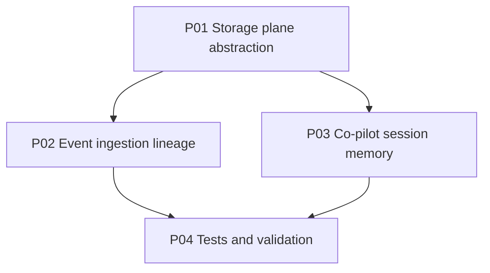
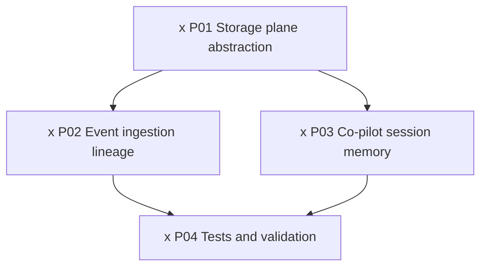

<!-- markdownlint-disable-file -->
# RPI Plan: Scalaton durable event storage and session memory

## Task Metadata

* Task ID: scalaton-durable-storage-session-memory
* Created: 2026-11-05
* Business source: [docs/scalaton-adr-002-durable-event-storage-and-session-memory.md](../../../docs/scalaton-adr-002-durable-event-storage-and-session-memory.md) (ADR-SCALATON-002)

## Executive Summary

The project docs were updated to add ADR-SCALATON-002, which makes Unity Catalog-governed Delta tables the durable system of record for inbound events, normalized events, workflow runs, audit, external actions, dead letters, and redacted session messages, with Mosaic AI Vector Search as a derived semantic index. The Release 1 scaffold stance (established by the existing code) is to define typed storage ports now with deterministic in-memory implementations and swap to Delta/Vector Search later behind the same interfaces.

This plan closes the gap between ADR-SCALATON-002 and the current backend by introducing a cohesive storage plane (`backend/app/storage/`), persisting event ingestion lineage and workflow runs through it, adding idempotent duplicate-event handling, and adding redacted co-pilot/workflow session memory. No live Delta or Vector Search integration is introduced; those remain Release 2 behind the same ports.

### What You May Not Know

* The current `AuditStore` and `DeadLetterStore` already follow the "in-memory stub, Delta later" pattern; this plan composes them into a single storage plane rather than rewriting them.
* `WorkflowService._records` is an ad-hoc in-memory dict used for BFF reads. ADR-SCALATON-002 §9 says caches must be non-authoritative; this plan keeps `_records` as a cache and adds a durable `workflow_runs` repository as the record.
* `/api/copilot/stream` currently streams a fixed `mock_copilot_reply` with no session identity or persistence.

## Phase Checklist

### Before

### After

<!-- rpi:phase id=P01 -->
### [x] P01: Storage plane abstraction

Introduce a cohesive, swappable storage plane covering the ADR-SCALATON-002 datasets as typed in-memory repositories, wired through the dependency container.

<!-- rpi:task id=P01-T01 -->
#### [x] P01-T01: Create the storage repositories and container

Goals:
* The backend exposes one `Repositories` container with typed, append-only/upsert in-memory repositories for the ADR-SCALATON-002 datasets, so ingestion, workflow, and session code persists through a uniform governed-storage port.

Requirements:
* Implements ADR-SCALATON-002 §3 storage model and §9 cache-non-authoritative rule. Supports PR-002, PR-010, PR-011.
* Provides repositories for `bronze_inbound_events`, `silver_normalized_events`, `workflow_runs`, `external_actions`, and `session_messages`, and composes the existing `AuditStore` (`audit_events`) and `DeadLetterStore` (`dead_letter_events`).
* Each repository documents that a governed Delta table replaces it later (ADR-SCALATON-002), keeping the port stable for the Release 2 live implementation.
* `bronze_inbound_events` is append-only and immutable; `workflow_runs` and `external_actions` support idempotent upsert keyed by correlation ID and idempotency key respectively.

Details:
* Model each dataset with a small Pydantic row model matching the ADR-SCALATON-002 §3 required fields; keep rows JSON-native so a later Delta writer is mechanical.
* Compose, do not rewrite, the existing [backend/app/audit/store.py](../../../backend/app/audit/store.py) and [backend/app/reliability/deadletter.py](../../../backend/app/reliability/deadletter.py).

References:
* [docs/scalaton-adr-002-durable-event-storage-and-session-memory.md](../../../docs/scalaton-adr-002-durable-event-storage-and-session-memory.md): §3 storage model, §5 session memory, §9 validation.
* [docs/scalaton-technology-architecture.md](../../../docs/scalaton-technology-architecture.md): §5 data and storage architecture.

Dependencies:
* None

<!-- rpi:task id=P01-T02 -->
#### [x] P01-T02: Wire the storage plane into the dependency container

Goals:
* The orchestrator, connectors, and routes obtain the storage plane from `Deps`, with the existing `audit` and `dead_letter` fields backed by the same repository instances for backward compatibility.

Requirements:
* Implements ADR-SCALATON-002 §4 event-ingestion procedure dependency surface.
* `Deps` exposes a `repos` field; `Deps.audit` and `Deps.dead_letter` reference the repositories inside `repos` so existing callers and tests are unaffected.

Details:
* Keep `Deps.build` the single construction point so the live Delta-backed `Repositories` drops in later behind the same field.

References:
* [backend/app/orchestration/deps.py](../../../backend/app/orchestration/deps.py): dependency container.

Dependencies:
* P01-T01

<!-- rpi:phase id=P02 -->
### [x] P02: Event ingestion lineage

Persist the bronze/silver/workflow-run lineage and external-action ledger through the storage plane, with idempotent duplicate-event handling.

<!-- rpi:task id=P02-T01 -->
#### [x] P02-T01: Persist ingestion lineage and workflow runs

Goals:
* Every started incident appends an immutable bronze record and a normalized silver record and upserts a durable `workflow_runs` row, so the workflow is recoverable and auditable independent of the in-memory cache.

Requirements:
* Implements ADR-SCALATON-002 §4 steps 4-6 and §5.1 working memory. Supports PR-002, PR-011.
* `WorkflowService.start_incident` writes `bronze_inbound_events` (append-only), `silver_normalized_events`, and a `workflow_runs` row carrying status, correlation ID, incident references, and timestamps, updated as the run reaches its terminal state.
* The in-memory `_records` cache remains the BFF read source and is explicitly non-authoritative (ADR-SCALATON-002 §9).

Details:
* Normalize the validated `IncidentEvent` into a provider-independent canonical shape for silver; keep bronze as the validated provider payload plus receipt metadata.

References:
* [docs/scalaton-adr-002-durable-event-storage-and-session-memory.md](../../../docs/scalaton-adr-002-durable-event-storage-and-session-memory.md): §4 ingestion, §5.1 working memory.
* [backend/app/orchestration/service.py](../../../backend/app/orchestration/service.py): workflow service.

Dependencies:
* P01-T02

<!-- rpi:task id=P02-T02 -->
#### [x] P02-T02: Idempotent duplicate events and external-action ledger

Goals:
* A duplicate inbound event is safely acknowledged without creating a duplicate workflow, and every gated external write records an idempotency-keyed `external_actions` row.

Requirements:
* Implements ADR-SCALATON-002 §4 duplicate-event rule and §3 `external_actions`. Supports PR-007, PR-009, PR-010.
* `start_incident` returns the existing workflow record when an event ID was already ingested, rather than starting a second run.
* `submit_jira` and `approve_change_request` append an `external_actions` row with idempotency key, target system, request hash, outcome, and external record ID.

Details:
* Reuse [backend/app/security/idempotency.py](../../../backend/app/security/idempotency.py) `derive_idempotency_key` for the external-action key.

References:
* [docs/scalaton-adr-002-durable-event-storage-and-session-memory.md](../../../docs/scalaton-adr-002-durable-event-storage-and-session-memory.md): §4 duplicate handling, §3 external actions.

Dependencies:
* P02-T01

<!-- rpi:phase id=P03 -->
### [x] P03: Co-pilot session memory

Add redacted, durable conversation memory for the co-pilot surface per ADR-SCALATON-002 §5.2.

<!-- rpi:task id=P03-T01 -->
#### [x] P03-T01: Persist redacted session messages on the co-pilot stream

Goals:
* The co-pilot stream records a redacted user message and the redacted assistant reply in `session_messages`, so conversation memory survives restarts and never depends on browser storage.

Requirements:
* Implements ADR-SCALATON-002 §5.2 conversation memory and §8 redaction-before-store. Supports PR-005, PR-012.
* `session_messages` rows include `session_id`, `correlation_id`, `actor_id` or service identity, `role`, `content_redacted`, `created_at`, and `retention_until`.
* Message content is redacted with the existing redaction primitive before it is stored; raw secrets and credentials are never persisted.
* `CopilotPrompt` accepts an optional `session_id` and `correlation_id`; a missing `session_id` is generated server-side and is stable for the exchange.

Details:
* Keep the streamed frame shape unchanged (`parseDataPayload`); persistence happens around the stream, accumulating the reply text for the stored assistant message.

References:
* [docs/scalaton-adr-002-durable-event-storage-and-session-memory.md](../../../docs/scalaton-adr-002-durable-event-storage-and-session-memory.md): §5.2 conversation memory, §8 redaction.
* [backend/app/api/console.py](../../../backend/app/api/console.py): co-pilot stream route.
* [backend/app/security/redaction.py](../../../backend/app/security/redaction.py): redaction primitive.

Dependencies:
* P01-T02

<!-- rpi:task id=P03-T02 -->
#### [x] P03-T02: Expose conversation memory retrieval

Goals:
* An operator surface can read the redacted conversation history for a session, loading only the minimum stored context.

Requirements:
* Implements ADR-SCALATON-002 §5.2 minimum-context loading. Supports PR-005.
* A `GET /api/copilot/sessions/{session_id}` route returns the ordered redacted messages for a session.

Details:
* Return the stored redacted rows as-is; no re-redaction is required because content is redacted on write.

References:
* [backend/app/api/console.py](../../../backend/app/api/console.py): console routes.

Dependencies:
* P03-T01

<!-- rpi:phase id=P04 -->
### [x] P04: Tests and validation

<!-- rpi:task id=P04-T01 -->
#### [x] P04-T01: Add storage, ingestion, and session-memory tests

Goals:
* Automated tests prove the storage plane persists lineage, enforces idempotency, and stores only redacted session content, keeping the existing suite green.

Requirements:
* Implements ADR-SCALATON-002 §9 validation requirements for duplicate delivery, idempotency, correlation ID presence, and session retrieval.
* Tests cover: bronze/silver/workflow-run persistence on `start_incident`; duplicate-event idempotency; external-action ledger entries; session-message redaction-before-store and retrieval.
* The full backend suite passes.

Details:
* Prefer the existing `conftest.py` fixtures and `TestClient` patterns.

References:
* [backend/tests](../../../backend/tests): existing test suite and fixtures.

Dependencies:
* P02-T02
* P03-T02

## User Decisions and Requirements

### Confirmed User Direction

* The user invoked `/rpi-implement` with the instruction to find the gap against the updated project markdown docs and then plan and implement the code. The gap resolved to ADR-SCALATON-002 durable storage and session memory.

### Planning Decisions and Feedback

* D1: Implement ADR-SCALATON-002 datasets as Release 1 in-memory ports (not live Delta), matching the existing adapter/connector scaffold stance; live Delta and Vector Search remain Release 2 behind the same ports.
* D2: Keep `WorkflowService._records` as a non-authoritative cache and add a durable `workflow_runs` repository, per ADR-SCALATON-002 §9.

## Planning Readiness and Next Step

* Readiness: Ready. The gap is evidence-backed by ADR-SCALATON-002 and the current code; no blocking critique findings.

## Goals

* Close the ADR-SCALATON-002 gap with a cohesive, swappable storage plane and redacted session memory, without introducing live external dependencies.

## Scope and Non-Goals

* In scope: in-memory storage repositories, ingestion lineage, idempotency, external-action ledger, co-pilot session memory, tests.
* Non-goals: live Unity Catalog Delta tables, Mosaic AI Vector Search indexing, LangGraph Delta checkpointer, retention/compaction jobs (all Release 2).

## Functional Requirements

* FR-S1: Persist bronze, silver, and workflow-run lineage for every started incident.
* FR-S2: Acknowledge duplicate events idempotently and record idempotency-keyed external actions.
* FR-S3: Store redacted co-pilot session messages and expose retrieval.

## Non-Functional Requirements

* NFR-S1: No raw secrets or credentials persisted; redaction before session storage.
* NFR-S2: Storage ports stable for a later Delta implementation; caches non-authoritative.

## Risks and Open Questions

* R1: Over-persisting could change `start_incident` behavior. Mitigation: keep `_records` and reads unchanged; add persistence alongside.

## Dependencies

* Existing [backend/app/security/idempotency.py](../../../backend/app/security/idempotency.py), [backend/app/security/redaction.py](../../../backend/app/security/redaction.py), [backend/app/audit/store.py](../../../backend/app/audit/store.py), [backend/app/reliability/deadletter.py](../../../backend/app/reliability/deadletter.py).

## Sources

* [docs/scalaton-adr-002-durable-event-storage-and-session-memory.md](../../../docs/scalaton-adr-002-durable-event-storage-and-session-memory.md)
* [docs/scalaton-product-requirements-document.md](../../../docs/scalaton-product-requirements-document.md)
* [docs/scalaton-design-specification.md](../../../docs/scalaton-design-specification.md)
* [docs/scalaton-technology-architecture.md](../../../docs/scalaton-technology-architecture.md)

## Critique Disposition

* No separate critique was run; a critique is optional for this scope and is not a blocker.

## Follow-Up Items

* FU1 (Release 2, outside immediate scope): live Unity Catalog Delta-backed `Repositories`, LangGraph durable checkpointer, and Vector Search semantic-memory refresh. Owner: Architecture/Engineering per ADR-SCALATON-002 §10.

## Handoff

* Ready for implementation under `/rpi-implement`.
