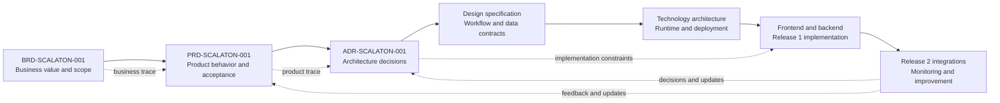

# Scalaton Documentation — AI System Development Lifecycle

Scalaton documentation is organized around the AI System Development Lifecycle (AI SDLC). Each phase has a primary document, an approval gate, and downstream traceability.

## Lifecycle order

| Phase | Procedure | Primary document | Gate/output |
|---|---|---|---|
| 1. Business alignment | Define the problem, users, value, scope, risks, data availability, and success measures. | [Business Requirements Document](scalaton-business-requirements-document.md) | BRD-SCALATON-001 approved |
| 2. Product and data design | Define journeys, AI behavior, data inputs, quality measures, fallback behavior, and acceptance criteria. | [Product Requirements Document](scalaton-product-requirements-document.md) | PRD-SCALATON-001 approved |
| 3. Architecture and modeling | Record technical choices, model/retrieval approach, governance, security, reliability, and trade-offs. | [ADR-001](scalaton-adr-001-governed-human-in-the-loop-architecture.md) and [ADR-002](scalaton-adr-002-durable-event-storage-and-session-memory.md) | ADR-SCALATON-001 and ADR-SCALATON-002 accepted |
| 4. Engineering and integration | Implement typed contracts, workflow states, adapters, connectors, user interfaces, storage, and test seams. | [Design specification](scalaton-design-specification.md) and [technology architecture](scalaton-technology-architecture.md) | Release 1 scaffold gate |
| 5. Deployment and operations | Validate live integrations, monitor quality and reliability, manage drift, and improve the system. | PRD and ADR updates | Release 2 readiness gate and operational review |

## Authoritative document relationships

## Shared lifecycle contract

The canonical workflow is:

`received → validating → collecting_evidence → diagnosing → drafting → awaiting_human_review`

Terminal or exception states are `resolved_with_recommendation`, `rejected`, `failed`, and `dead_lettered`.

Scalaton may analyze, summarize, and draft. It must not submit a change request, change production state, close or materially change an incident, or create a policy-controlled external record without explicit Microsoft Teams approval and backend authorization.

## Supporting documentation

- [`../README.md`](../README.md) — repository overview and quick starts
- [`../frontend/README.md`](../frontend/README.md) — operator console implementation
- [`../backend/README.md`](../backend/README.md) — API and orchestration implementation
- [Design specification](scalaton-design-specification.md) — workflows, contracts, governance, reliability, and tests
- [Technology architecture](scalaton-technology-architecture.md) — runtime layers, deployment, security, and operations

Historical implementation plans, reviews, and change records are stored under [`../.copilot-tracking/`](../.copilot-tracking/). They preserve implementation history and should be interpreted against the current BRD, PRD, and ADR.
