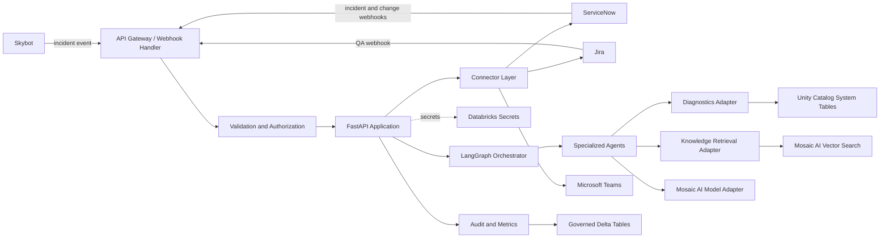
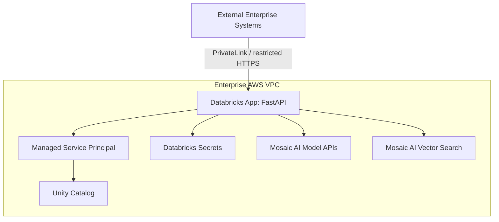

# Scalaton — Technology Architecture Design

## 1. Scope

This document describes the deployable technology architecture for the Scalaton AI Operations Support Co-pilot. It complements `design-specification.md` and the [ADR](scalaton-adr-001-governed-human-in-the-loop-architecture.md) by defining runtime layers, component boundaries, data flows, deployment topology, and operational controls.

The business and product sources are the [BRD](scalaton-business-requirements-document.md) and [PRD](scalaton-product-requirements-document.md).

This document is the engineering and deployment architecture for the AI SDLC. It implements the accepted ADR and provides the technical constraints consumed by the Release 1 scaffold and Release 2 integration-readiness gate. See the [AI SDLC documentation index](README.md).

## 2. Architecture principles

- **Private by default:** keep application, data, model access, and audit records within the enterprise perimeter.
- **Least privilege:** every connector and agent receives only the permissions required for its task.
- **Human approval for change:** analysis and drafting may be automated; production-impacting actions require explicit approval.
- **Contract-first integration:** validate all inbound and outbound payloads against versioned schemas.
- **Observable workflows:** propagate one correlation ID through every agent, connector, and audit event.
- **Fail safely:** timeouts, retries, idempotency, and dead-letter handling must prevent duplicate or uncontrolled actions.

## 3. Logical architecture

### Layer responsibilities

| Layer | Components | Responsibility |
| --- | --- | --- |
| Edge | Webhook endpoints, health endpoints | Receive events, enforce request limits, and expose readiness status. |
| Security | Signature verifier, RBAC policy, redaction | Authenticate callers, authorize actions, and remove sensitive data. |
| Application | FastAPI routes and workflow service | Translate external requests into internal commands and responses. |
| Orchestration | LangGraph state machine | Route agents, persist workflow state, pause for approvals, and recover failures. |
| Intelligence | Log, knowledge, diagnosis, and change agents | Retrieve evidence and produce schema-validated drafts. |
| Data access | Unity Catalog and Vector Search adapters | Provide governed diagnostics and relevant historical context. |
| Integration | ServiceNow, Jira, Teams, and Skybot clients | Encapsulate external API contracts, retries, and idempotency. |
| Platform | Databricks App runtime, Secrets, audit tables | Provide execution, credentials, governance, and operational telemetry. |

## 4. Runtime component design

### 4.1 FastAPI application

The FastAPI process is the stateless request boundary. It should provide separate route groups for:

- `/webhooks/servicenow`
- `/webhooks/jira`
- `/webhooks/skybot`
- `/actions/teams`
- `/health/live`
- `/health/ready`

Routes must perform authentication and basic schema validation before enqueueing or invoking a workflow. Long-running diagnosis should not block the inbound webhook response; the handler should acknowledge accepted work and process the workflow asynchronously.

### 4.2 LangGraph orchestration

The workflow state should include:

- correlation ID and source event ID;
- incident and external record references;
- sanitized event context;
- retrieved evidence references;
- diagnosis and confidence;
- approval state;
- connector results and error information.

Recommended states are `received`, `validating`, `collecting_evidence`, `diagnosing`, `drafting`, `hot_fix`, `recording_operations`, `change_request_automation`, `awaiting_human_review`, `executing_approved_action`, `completed`, and `failed`.

State transitions must be explicit. External writes belong in dedicated nodes so they can be authorized, retried, and audited independently from model inference.

### 4.3 Agent boundaries

- **Log Agent:** reads permitted workflow and Spark execution metadata; it cannot write production data.
- **Knowledge Agent:** retrieves runbooks and historical incidents; retrieved text is untrusted context, not executable instruction.
- **Diagnosis Agent:** converts evidence into a structured diagnosis using Mosaic AI.
- **Communication Agent:** creates ServiceNow notes and Teams cards from validated results.
- **Escalation Agent:** maps approved context into Jira fields and preserves cross-system links.
- **Change Agent:** drafts change requests and stops at the approval boundary.
- **Operations Recording:** upserts raw/normalized events, workflow state, audit records, external actions, and approved semantic-memory updates.

Agents communicate through typed internal models rather than free-form strings.

## 5. Data and storage architecture

### Governed data domains

| Domain | Storage | Access pattern |
| --- | --- | --- |
| Workflow audit | Delta tables governed by Unity Catalog | Append-only events and approval records. |
| Execution diagnostics | Unity Catalog system tables | Read-only queries scoped to required metadata. |
| Knowledge source | Governed Delta tables | Curated runbooks, historical tickets, and remediation notes. |
| Vector index | Mosaic AI Vector Search | Similarity retrieval with source references and freshness metadata. |
| Secrets | Databricks Secrets | Runtime-only credential retrieval. |

Audit records should include event type, actor or service principal, correlation ID, source ID, timestamp, outcome, payload hash, and external record ID. Raw secrets and unnecessary personal data must not be stored.

## 6. Integration architecture

Each external system has an adapter with the following contract:

1. Validate request and response schemas.
2. Attach correlation and idempotency headers where supported.
3. Apply bounded retries only to safe transient failures.
4. Normalize provider errors into internal error categories.
5. Emit an audit event for every external read and write.

### Idempotency

The application must derive a stable action key from the source event, target system, target record, and action type. Before creating a Jira issue or submitting a change request, the adapter checks the audit store and provider-side reference for an existing successful action.

### Webhook security

Inbound webhooks require provider signature verification, timestamp freshness checks, replay protection, source allowlisting, and rate limiting. A webhook is acknowledged only after authenticity and minimum schema checks pass.

## 7. Deployment topology

The Databricks App runs with a managed service principal. Network egress is restricted to approved endpoints for ServiceNow, Jira, Microsoft Teams, Skybot, Mosaic AI, and Vector Search. Production and non-production environments must use separate app configurations, secrets, service principals, and external integration endpoints.

## 8. Security architecture

- Use TLS for all network connections and validate certificates.
- Store connector credentials and webhook signing keys only in Databricks Secrets.
- Grant Unity Catalog permissions to the service principal, not individual agent prompts.
- Keep model prompts limited to sanitized, task-relevant context.
- Treat runbooks, tickets, logs, and webhook fields as untrusted input to defend against prompt injection.
- Enforce role checks again when a Teams action reaches the backend; card visibility is not authorization.
- Record approvals with the approver identity, exact action payload hash, timestamp, and resulting external record.

## 9. Reliability and observability

The platform must provide:

- structured logs with correlation ID and workflow state;
- metrics for request latency, workflow duration, model latency, token usage, retrieval quality, retry count, and connector failures;
- traces spanning webhook receipt, agent nodes, model calls, retrieval, and external writes;
- alerts for failed workflows, dead-letter growth, authentication failures, and approval timeouts;
- bounded retry with exponential backoff and jitter;
- dead-letter persistence for events that require operator review.

Health checks must distinguish process liveness from dependency readiness. A readiness failure must not expose credentials or incident content.

## 10. Environment configuration

Configuration should be supplied through the Databricks App environment and secret references, not source code. Required configuration categories include:

- approved external base URLs;
- model endpoint names and timeouts;
- Vector Search index identifiers;
- Unity Catalog catalog and schema names;
- retry and rate-limit settings;
- Teams channel and approval-policy identifiers;
- feature flags for external writes.

External writes should be disabled by default in development and test environments.

## 11. Technology decisions and assumptions

- Python and FastAPI are the application runtime.
- LangGraph is the orchestration framework.
- Mosaic AI Foundation Model APIs provide model inference.
- Mosaic AI Vector Search provides retrieval over governed Delta-backed knowledge.
- Unity Catalog governs data permissions and audit storage.
- REST, JWT, OAuth, and provider webhooks are used for external integrations.
- Exact package versions, deployment descriptors, persistence implementation, and asynchronous execution mechanism remain implementation decisions until the Release 2 production integration design is approved.